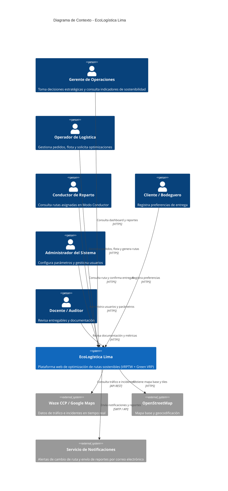
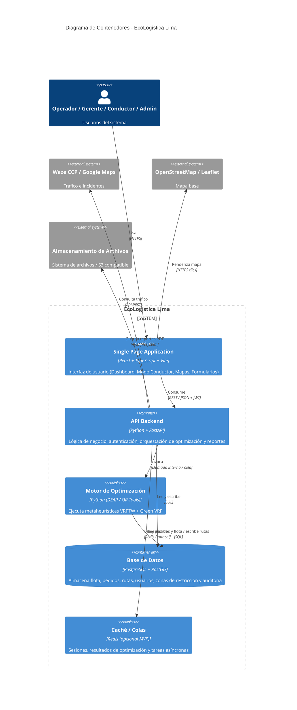
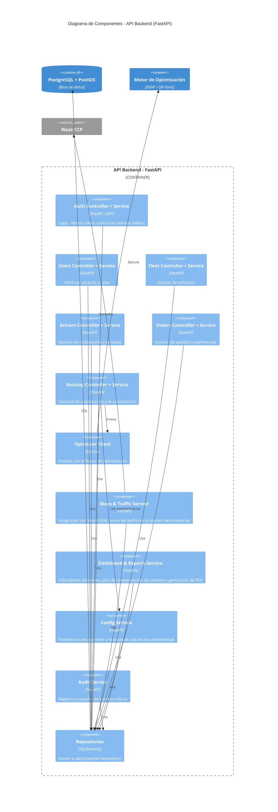
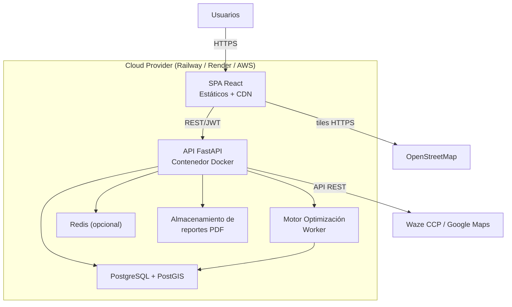
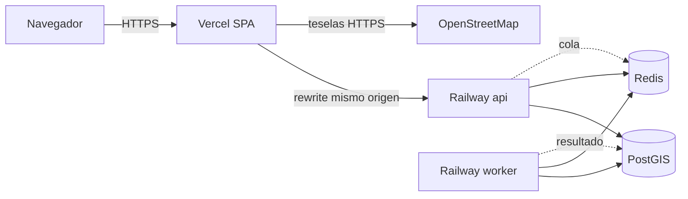

[← Volver al README principal](../../README.md)

# UNIVERSIDAD CONTINENTAL
## Taller de Proyectos 2

# 12. Arquitectura de Software – Modelo C4

**Nombre del Proyecto:** EcoLogística Lima – Optimizador de Rutas Sostenibles para DistriRápido S.A.C.  
**Fecha:** 04/09/2026  
**Versión:** 1.0.2  
**Project Manager:** Carhuapoma Fano, Eilene Elizabeth  

---

## 1. Introducción

Se presenta la arquitectura del sistema EcoLogística Lima utilizando el modelo **C4** (Context, Containers, Components, Code) en sus tres primeros niveles, tal como exige la consigna de arquitectura.  
Los diagramas se generan en sintaxis **Mermaid** para garantizar trazabilidad y versionamiento en el repositorio.

---

## 2. Nivel 1 – Diagrama de Contexto (System Context)

Muestra el sistema como una caja negra y sus interacciones con los actores y sistemas externos.

> **Alcance de las notificaciones (coherencia con el documento 05).** Dentro del MVP, las notificaciones a conductores y clientes se resuelven mediante avisos **in-app** y **correo electrónico**. El envío por SMS queda fuera del alcance por costo (restricción C-01). Este sistema externo da soporte a la notificación exigida por RF-007 ("notifica a los conductores involucrados").
---
## 3. Nivel 2 – Diagrama de Contenedores (Containers)
Descompone el sistema en contenedores desplegables (aplicaciones, bases de datos, servicios).

#### Descripción del Nivel 2

| Componente | Tecnología | Responsabilidad principal |
|------------|-----------|--------------------------|
| SPA | React + TypeScript + Vite | Toda la experiencia de usuario |
| API Backend | FastAPI | Autenticación, CRUD, orquestación, generación de reportes |
| Motor de Optimización | Python + DEAP / OR-Tools | Cálculo de rutas (proceso intensivo en CPU) |
| Base de Datos | PostgreSQL + PostGIS | Persistencia transaccional y geoespacial |
| Caché / Colas | Redis (opcional en MVP) | Sesiones y desacople del motor de optimización |

---

## 4. Nivel 3 – Diagrama de Componentes (API Backend)

#### Descripción de Componentes principales

| Componente | Responsabilidad |
|------------|----------------|
| Auth Controller + Service | Autenticación JWT, bloqueo por intentos fallidos (RN-019) |
| Fleet / Drivers / Orders | CRUD completo de las entidades de negocio |
| Routing Controller | Orquesta la generación y re-optimización de rutas |
| Optimizer Client | Desacopla la API del motor de cálculo intensivo |
| Maps & Traffic Service | Integra datos de tráfico y valida zonas restringidas |
| Dashboard & Reports Service | Calcula indicadores, el plan de compensación de carbono y genera los PDFs de sostenibilidad |
| Config Service | Administra los parámetros del algoritmo y los factores de cálculo usados por RN-014, RN-016, RN-017 y RN-018 |
| Audit Service | Cumple RNF-010 y Ley N° 29733 |
| Repositories | Única capa de acceso a datos (SQLAlchemy) |

#### Trazabilidad Componente – Requisito – Tabla de BD

| Componente | Requisitos funcionales | Tablas principales (doc. 11) |
|---|---|---|
| Auth Controller + Service | RF-011 | usuario, log_auditoria |
| Users Controller + Service | RF-011 | usuario |
| Fleet Controller + Service | RF-001 | vehiculo |
| Drivers Controller + Service | RF-008 | conductor |
| Orders Controller + Service | RF-002, RF-009 | pedido, cliente, preferencia_cliente |
| Routing Controller + Optimizer Client | RF-003, RF-007 | ruta, asignacion_ruta, detalle_ruta, incidencia |
| Maps & Traffic Service | RF-004, RF-007 | zona_restriccion, incidencia |
| Dashboard & Reports Service | RF-005, RF-006, RF-010 | emision_co2, ruta, reporte |
| Config Service | RF-012 | configuracion_sistema |
| Audit Service | RF-012 | log_auditoria |

## 5. Decisiones Arquitectónicas Relevantes
1. Separación del Motor de Optimización
Se ejecuta como proceso independiente (o worker) para no bloquear la API y cumplir los SLAs de ≤ 45 s / ≤ 30 s.
2. API Gateway implícito
FastAPI actúa como único punto de entrada. Toda autenticación y autorización se resuelve en la capa de Auth.
3. Base de datos única
PostgreSQL + PostGIS cubre tanto datos transaccionales como geoespaciales, evitando la complejidad de un polyglot persistence en el MVP.
4. Frontend desacoplado
La SPA consume únicamente la API REST documentada (OpenAPI). Permite evolución independiente y facilita el “Modo Conductor” liviano.
5. Principio de mínimo privilegio
Cada componente solo accede a los repositorios que necesita. El control de acceso fino se implementa en los servicios según la matriz RBAC del documento 08.
6. Observabilidad básica
Health checks, logs estructurados y tabla de auditoría permiten cumplir RNF-006 y RNF-010 desde la Iteración 2.

## 6. Vista de Despliegue (resumen)

## 7. Despliegue de producción

El entorno público, vigente al 20/11/2026, no es el diagrama genérico de la sección 6. La interfaz está en Vercel y el backend en Railway. El navegador habla con un solo origen: Vercel reenvía las rutas de la API.

| Pieza | Dónde corre | Red |
| --- | --- | --- |
| SPA React (Vite, Node 22, `frontend/`) | Vercel, equipo `eco-pfa`, proyecto `ecologistica-lima` | Pública: [https://ecologistica-lima-beige.vercel.app](https://ecologistica-lima-beige.vercel.app) |
| API FastAPI | Railway, servicio `api` (`19dd40e0-d91a-4674-8ca8-557a21c46806`), imagen `backend/Dockerfile` | Pública: [https://api-production-b8dfa3c0.up.railway.app](https://api-production-b8dfa3c0.up.railway.app) (`/health`, `/docs`) |
| Worker DEAP | Railway, servicio `worker` (`e68f06e4-9cc5-40cd-a3bd-ba6945d1f28f`), la misma imagen, `PROCESO=worker` | Privada. Sin dominio. |
| PostgreSQL 16 + PostGIS 3.4 | Railway, servicio `db`, imagen `postgis/postgis:16-3.4` | Privada. Sin dominio. |
| Redis | Railway, servicio `Redis` | Privada. Sin dominio. |

Proyecto Railway `81c6f2b1-cac0-4061-bc96-6d8bd46754be`, entorno `production`. `api` y `worker` se publican con `railway up` (no hay enlace del servicio a GitHub). El entrypoint aplica Alembic, siembra y arranca uvicorn. `ecologistica-lima.vercel.app` es otro sitio.

`frontend/vercel.json` copia la regla del `Caddyfile`: `/docs`, `/docs/:path*` y `/openapi.json` van siempre a la API. `/usuarios`, `/conductores`, `/pedidos` y `/rutas` sirven `index.html` cuando `Accept` contiene `text/html`, y el resto de esas rutas, más `/auth`, `/vehiculos`, `/clientes`, `/optimizaciones`, `/indicadores` y `/health`, se reenvían a la API. Lo demás, salvo `/assets/`, cae en `index.html`.

El workflow [`.github/workflows/deploy-production.yml`](../../.github/workflows/deploy-production.yml) repite ese despliegue después de que `Tests` termine en verde en un push a `main`, o al publicar una etiqueta `v*`. Usa el entorno de GitHub `production` y los secretos `RAILWAY_TOKEN`, `VERCEL_TOKEN`, `VERCEL_ORG_ID` y `VERCEL_PROJECT_ID`.

---

## Historial de Control de Cambios

| Versión | Fecha | Autor | Descripción |
|---|---|---|---|
| 1.0.0 | 04/09/2026 | Equipo EcoLogística Lima | Modelo C4 de contexto, contenedores y componentes, con una vista de despliegue genérica. |
| 1.0.1 | 04/09/2026 | Equipo EcoLogística Lima | El archivo queda en V_1_0_1, alineado al encabezado. |
| 1.0.2 | 20/11/2026 | Equipo EcoLogística Lima | Sección 7: producción real. Vercel sirve la SPA y Railway corre `api`, `worker`, PostGIS y Redis. El archivo pasa a V_1_0_2. |

---

**Fin del documento 12. Modelo C4 V_1_0_2.md**

[← Volver al README principal](../../README.md)
