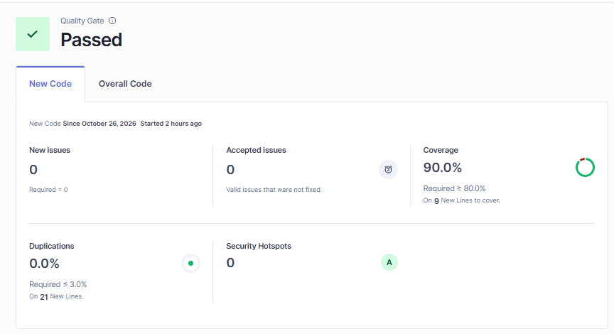

[← Volver al README Principal](../../../README.md)

# Evaluación de Calidad de Código — SonarQube

**Nombre del Proyecto:** EcoLogística Lima – Optimizador de Rutas Sostenibles para DistriRápido S.A.C.  
**Fecha de Análisis:** 2026-10-26  
**Versión del Análisis:** V_1_0_0  

Línea base local sobre la rama `main`, commit `efcfcfb`. Servidor SonarQube Community. Clave de proyecto `pfa-taller`. La evidencia final es el Quality Gate de New Code en la instancia local del equipo, el 2026-10-26: **PASSED**. La columna Después de la sección 4 y la sección 5 corresponden a la verificación en Community Build 26.10.0.133078 sobre el commit `aaa13b6`.

## 1. Resumen Ejecutivo de Quality Gate

- **Estado del Quality Gate:** PASSED
- **Issues nuevos:** 0 (requerido 0). Issues aceptados: 0
- **Cobertura de código nuevo:** 90.0 % (requerido ≥ 80 %; 9 líneas nuevas por cubrir)
- **Duplicación de código nuevo:** 0.0 % (requerido ≤ 3.0 %; 21 líneas nuevas)
- **Security hotspots:** 0. Calificación A

El pase es el de la pestaña New Code en la instancia local del equipo. La captura y el detalle están en la sección 6. La verificación independiente en la VM (cobertura global 97.6 %, `python:S2115` en 0, sin BLOCKER) está en la sección 5. La línea base del commit `efcfcfb` —53.1 % de cobertura, 111 issues, 1 vulnerabilidad bloqueante y 616 minutos de deuda— queda en la sección 2.

## 2. Métricas Principales

| Categoría | Cantidad Detectada | Severidad (Bloqueante / Alta / Media / Baja) |
|---|---|---|
| **Bugs** | 0 | Sin hallazgos. Rating de confiabilidad A. |
| **Vulnerabilidades** | 1 | Bloqueante (1). Rating de seguridad E. |
| **Code Smells** | 110 | Bloqueante 46, Alta 9, Media 47, Baja 8. Rating de mantenibilidad A. |
| **Security Hotspots** | 2 | Media (2), ambos `TO_REVIEW`, regla `python:S2245`. |

Severidad de los 111 issues (vulnerabilidad + code smells): Bloqueante 47, Alta 9, Media 47, Baja 8.

| Regla | Tipo | Severidad | Cantidad | Dónde |
|---|---|---|---|---|
| secrets:S6698 | Vulnerabilidad | Bloqueante | 1 | `backend/app/core/config.py:12` |
| python:S8410 | Code smell | Bloqueante | 44 | Dependencias `Depends` y `Query` en `backend/app/api/routes/` |
| python:S8409 | Code smell | Bloqueante | 1 | `backend/app/api/routes/auth.py:15` |
| python:S8414 | Code smell | Bloqueante | 1 | `backend/app/main.py:31` |
| python:S3776 | Code smell | Alta | 5 | `evaluacion.py`, `metaheuristica.py`, `services/indicadores.py`, `services/rutas.py` |
| python:S1192 | Code smell | Alta | 3 | `backend/app/models/entities.py` |
| typescript:S2004 | Code smell | Alta | 1 | `frontend/src/pages/MapaRutas.tsx:62` |
| python:S8415 | Code smell | Media | 1 | `backend/app/api/routes/health.py:15` |
| python:S5864 | Code smell | Media | 2 | `backend/app/optimizacion/cola.py` |
| typescript:S6772 | Code smell | Media | 34 | Etiquetas de formulario en `frontend/src/pages/` |
| typescript:S6819 | Code smell | Media | 10 | `role="status"` y `role="region"` en páginas React |
| python:S5713 | Code smell | Baja | 3 | `backend/app/optimizacion/cola.py` |
| typescript:S6759 | Code smell | Baja | 3 | Props de `MapaRutas`, `App` y `AuthProvider` |
| typescript:S7735 | Code smell | Baja | 1 | `frontend/src/pages/RutasPage.tsx:200` |
| typescript:S7764 | Code smell | Baja | 1 | `frontend/src/pages/RutasPage.tsx:19` |

## 3. Plan de Remediación y Deuda Técnica

- **Deuda Técnica Estimada:** 616 minutos (10 h 16 min), `sqale_index` de la línea base.
- **Principales hallazgos y acciones correctivas:**

1. **secrets:S6698 (Bloqueante).** La URL por defecto de PostgreSQL llevaba usuario y contraseña escritos en `backend/app/core/config.py`. Corrección: `database_url` queda vacío en el código y se completa con `DATABASE_URL`. Si esa variable no viene, la URL se arma con `POSTGRES_USER`, `POSTGRES_PASSWORD`, `POSTGRES_HOST`, `POSTGRES_PORT` y `POSTGRES_DB`. La contraseña de demostración sigue en `.env.example`, en los valores por defecto de `docker-compose.yml` y en el workflow de CI, que es de donde la toma el proceso. Archivos: `backend/app/core/config.py`, `backend/tests/test_config_entorno.py`.

2. **python:S8410 (Bloqueante, 44).** FastAPI pedía `Annotated` en la inyección de dependencias y en `Query`. Corrección: cada `Depends` y cada `Query` de los endpoints pasa a `Annotated[...]`. El valor por defecto de `limite` y de la fecha opcional queda en `=`, que es la forma que acepta FastAPI 0.115. Archivos: `backend/app/api/routes/auth.py`, `health.py`, `indicadores.py`, `optimizaciones.py`, `rutas.py`, `clientes.py`, `conductores.py`, `pedidos.py`, `usuarios.py`, `vehiculos.py`.

3. **python:S8409 (Bloqueante).** `POST /auth/login` repetía `response_model=TokenResponse` junto al retorno `-> TokenResponse`. Corrección: se quitó `response_model`. Los códigos 401, 403 y 423 siguen declarados en `responses`. Archivo: `backend/app/api/routes/auth.py`.

4. **python:S8414 (Bloqueante).** `CORSMiddleware` no era el último `add_middleware`. En Starlette el último agregado es el más externo. Corrección: primero se registra `SecurityHeadersMiddleware` y al final `CORSMiddleware`, para que las cabeceras CORS cubran también esa respuesta. Archivo: `backend/app/main.py`.

5. **python:S3776 (Alta, 5).** Complejidad cognitiva por encima de 15: `evaluacion.py` `_armar_por_cercania` (17) y `mejorar_orden_local` (29), `metaheuristica.py` `_correr` (25), `services/indicadores.py` `consultar` (25) y `services/rutas.py` `salida_ruta` (32). Corrección: se extrajeron funciones con la misma secuencia de decisiones (elección del vecino, 2-opt, cruce y mutación del algoritmo genético, tablero e hidratación de la ruta). Archivos: `backend/app/optimizacion/evaluacion.py`, `backend/app/optimizacion/metaheuristica.py`, `backend/app/services/indicadores.py`, `backend/app/services/rutas.py`.

6. **python:S1192 (Alta, 3).** Literales repetidos en el modelo: `uuid_generate_v4()` (11), `usuario.id_usuario` (3) y `ruta.id_ruta` (3). Corrección: constantes de módulo `_UUID_V4`, `_FK_USUARIO` y `_FK_RUTA`. También se unificó `CURRENT_TIMESTAMP` en `_AHORA` para el mismo criterio. Archivo: `backend/app/models/entities.py`.

7. **typescript:S2004 (Alta).** En `MapaRutas` el dibujo de cada parada anidaba funciones a más de cuatro niveles. Corrección: `pintarParada`, `pintarRuta` y `dibujar` quedan en el módulo. El efecto solo importa Leaflet y llama a `dibujar`. Archivo: `frontend/src/pages/MapaRutas.tsx`.

8. **python:S8415 (Media).** `GET /health` lanzaba HTTP 503 sin declararlo. Corrección: `responses={503: ...}`. Archivo: `backend/app/api/routes/health.py`.

9. **python:S5864 y python:S5713 (Media y Baja).** En la cola Redis, `raise _traducir(exc)` elevaba una función que ya lanzaba (el analizador la veía como `None`) y `TimeoutError` era redundante porque ya lo cubre `OSError`. Corrección: `_traducir` devuelve `NoReturn` y se invoca directo; los `except` quedan en `(redis.RedisError, OSError)`. `TimeoutError` de Redis sigue cayendo en `RedisError`. Archivo: `backend/app/optimizacion/cola.py`.

10. **typescript:S6772 (Media, 34).** Entre el texto de la etiqueta y el control había un salto de línea. JSX elimina ese espacio, y la regla lo marca como ambiguo. Corrección: un comentario vacío `{/* */}` entre el texto y el `<input>` o `<select>`, que deja explícito que no hay espacio. El `label` sigue en rejilla con `gap`. Archivos: `frontend/src/pages/LoginPage.tsx`, `DashboardPage.tsx`, `PedidosPage.tsx`, `RutasPage.tsx`, `ConductoresPage.tsx`, `UsuariosPage.tsx`, `FlotaPage.tsx`.

11. **typescript:S6819 (Media, 10).** `role="status"` se reemplazó por `<output>` (rol implícito status) y `role="region"` del mapa por `<section aria-label>`. `.aviso`, `.exito` y `.alerta` usan `display: block` para conservar el bloque que antes daba `<p>`. Archivos: `DashboardPage.tsx`, `MapaRutas.tsx`, `RutasPage.tsx`, `ConductoresPage.tsx`, `PedidosPage.tsx`, `UsuariosPage.tsx`, `FlotaPage.tsx`, `frontend/src/styles.css`.

12. **typescript:S6759, S7735 y S7764 (Baja).** Las props de `MapaRutas`, `Modulo` y `AuthProvider` quedaron en `Readonly`. La condición de minutos de tramo quedó en forma positiva (`== null` primero). `window.setTimeout` pasó a `globalThis.setTimeout`. Archivos: `frontend/src/pages/MapaRutas.tsx`, `frontend/src/App.tsx`, `frontend/src/auth.tsx`, `frontend/src/pages/RutasPage.tsx`.

13. **python:S2245 (sin cambio de generador).** Los dos usos de `random` alimentan el cruce y la mutación del algoritmo genético, con semilla del plan y estado restaurado al salir. Es un uso no criptográfico. Decisión: **Safe**. No se cambió el generador: `secrets` no es sembrable y alteraría los planes. El detalle está en [04 OWASP V_1_0_0.md](./04%20OWASP%20V_1_0_0.md). Tras el extracto de complejidad, las llamadas quedan en `backend/app/optimizacion/metaheuristica.py` líneas 148 y 156. En Community Build 26.10 esa regla ya no es security hotspot: el análisis la publica como vulnerabilidad Major, impacto de seguridad Medium, con la etiqueta `former-hotspot`. En el servidor de la verificación se aceptaron las dos. Con eso, vulnerabilidades abiertas: 0 y hotspots: 0.

14. **python:S2115 (Bloqueante).** Hacer obligatoria la contraseña no alcanzó. El re-escaneo de `0ce075d` seguía marcando el f-string de `backend/app/core/config.py` línea 48: `postgresql+psycopg://{credencial}@{host}:`. La contraseña vive dentro de la interpolación, y la regla mira el literal. Corrección: si llega `DATABASE_URL`, se usa tal cual. Si falta `POSTGRES_PASSWORD`, `resolver_database_url` lanza `ValueError`. Si la contraseña está en el entorno, la URL sale de `sqlalchemy.engine.URL.create` con `password` como argumento y `render_as_string(hide_password=False)`. El código de la aplicación ya no tiene un literal de conexión. Docker Compose, la CI y pytest siguen definiendo `DATABASE_URL`, así que ese camino no cambia. La contraseña no vuelve al código. Archivos: `backend/app/core/config.py`, `backend/tests/test_config_entorno.py`.

15. **typescript:S9383 (bug).** El primer análisis de esta verificación marcó la promesa de `import("leaflet")` en `frontend/src/pages/MapaRutas.tsx`. Corrección: la expresión va con `void`, termina en `.catch` y, si el módulo no carga, muestra el aviso de teselas que ya existía. El análisis del commit `aaa13b6` dejó 0 bugs.

Un análisis anterior había dejado la cobertura de New Code en «Not computed». El `coverage.xml` llevaba en `<source>` la ruta absoluta del disco donde corrió pytest, y el lcov salía como `SF:src\App.tsx`. Corrección, sin reescribir nada a mano antes de escanear: `relative_files` en `backend/pyproject.toml`; al cerrar pytest, `<source>` queda en `.` y cada `filename` en `backend/app/...` con barras `/`. Al cerrar vitest, `frontend/vite.config.ts` deja cada `SF:` en `frontend/src/...` con barras `/`. `sonar.python.version` queda en 3.12. En la verificación de la sección 5 la cobertura salió calculada.

Medición local de esta revisión: pytest **97.71 %** de líneas sobre `app` (78 pruebas, antes 93.23 % con 67). Vitest (`@vitest/coverage-v8` 2.1.9) **99.54 %** de líneas sobre `frontend/src` (52 pruebas, antes 8.39 %). Las páginas, `App` y la sesión se montan con Testing Library y `fetch` simulado. SonarQube calculó la cobertura global en **97.6 %**.

## 4. Antes / Después

| Métrica | Antes (línea base 2026-10-26, `efcfcfb`) | Después (Community Build 26.10.0.133078, `aaa13b6`, 2026-10-27) |
|---|---|---|
| Quality Gate | PASSED (sin condiciones configuradas) | PASSED (Sonar way). Código nuevo: cobertura 87.5 %, duplicación 0.0 %, violaciones 0 |
| Cobertura | 53.1 % | 97.6 % (líneas 98.6 %, ramas 90.0 %; 3820 líneas a cubrir, 55 sin cubrir) |
| Duplicación | 0.0 % | 0.0 % |
| ncloc | 5399 | 5516 |
| Bugs | 0 (confiabilidad A) | 0 (confiabilidad A) |
| Vulnerabilidades | 1, Bloqueante, seguridad E | 0 abiertas, seguridad A. El análisis marcó 2 `python:S2245` Major (seguridad C, 20 min) y quedaron aceptadas |
| Code smells | 110 (Bloqueante 46, Alta 9, Media 47, Baja 8) | 0 (mantenibilidad A) |
| Security hotspots | 2, Media, `TO_REVIEW` | 0 (revisión de seguridad A) |
| Deuda técnica | 616 min | 0 min (`sqale_index` 0; confiabilidad 0 min; seguridad 0 min tras aceptar las dos S2245) |
| Cobertura frontend (vitest, líneas) | 6.3 % | 99.54 % local. SonarQube la incluye en el 97.6 % global. `MapaRutas.tsx` en Sonar: 96.8 % |
| Cobertura backend (pytest, líneas) | no figuraba aparte de SonarQube | 97.71 % local. `backend/app/core/config.py` en Sonar: 100 % |
| Pruebas backend | 64 pytest en verde | 78 pytest en verde |
| Pruebas frontend | 7 vitest en verde | 52 vitest en verde |

### Comandos para el re-escaneo

No reescriba el `<source>` de `backend/coverage.xml`. Pytest y vitest ya dejan las rutas relativas a la raíz del repositorio (`backend/app/...` y `frontend/src/...`, con barras `/`). SonarQube local en marcha, proyecto `pfa-taller`, token en `SONAR_TOKEN`.

PowerShell, con el escáner en Docker y el repositorio montado en `/usr/src`:

```powershell
cd backend
pytest --cov=app --cov-report=xml --cov-fail-under=80
cd ..\frontend
npx vitest run --coverage
cd ..
docker run --rm `
  -e SONAR_HOST_URL="http://host.docker.internal:9000" `
  -e SONAR_TOKEN="$env:SONAR_TOKEN" `
  -v "${PWD}:/usr/src" `
  sonarsource/sonar-scanner-cli
```

Si el escáner está instalado en el propio host:

```powershell
sonar-scanner -Dsonar.host.url="http://localhost:9000" -Dsonar.token="$env:SONAR_TOKEN"
```

`sonar-project.properties` apunta a `backend/app` y `frontend/src`, a `backend/coverage.xml` y a `frontend/coverage/lcov.info`, fija `sonar.python.version` en 3.12 y excluye pruebas, el directorio `frontend/src/test`, migraciones de Alembic y `backend/app/seed.py`.

## 5. Verificación en la VM (SonarQube Community Build)

Medición independiente de la instancia del equipo (sección 6). Se levantó `sonarqube:community` (Community Build 26.10.0.133078) y se analizó el commit `aaa13b6` con `sonarsource/sonar-scanner-cli` 8.1.0.6389, el `sonar-project.properties` del repositorio y los reportes `backend/coverage.xml` y `frontend/coverage/lcov.info`. Tarea de cómputo `e851cdd7-0f3d-4caf-bf56-80385251cc6c`, estado SUCCESS, 0 advertencias. Quality Gate **Sonar way**: PASSED.

Resultado del análisis, antes de aceptar hallazgos:

| Métrica | Valor |
|---|---|
| Quality Gate | PASSED. Condiciones de código nuevo: `new_coverage` 87.5 %, `new_duplicated_lines_density` 0.0 %, `new_violations` 0, `new_security_hotspots_reviewed` OK |
| Bugs | 0. Confiabilidad A. `typescript:S9383` quedó cerrado en este commit |
| Vulnerabilidades | 2, ambas `python:S2245`, severidad Major, impacto de seguridad Medium, 10 min cada una. Seguridad C |
| Code smells | 0. Mantenibilidad A |
| Cobertura | 97.6 %, calculada. Líneas 98.6 %, ramas 90.0 %. `config.py` 100 % (36 líneas a cubrir) |
| Duplicación | 0.0 % |
| Security hotspots | 0. Revisión de seguridad A |
| Deuda | `sqale_index` 0 min. Esfuerzo de confiabilidad 0 min. Esfuerzo de seguridad 20 min |
| ncloc | 5516 |
| `python:S2115` | 0 |
| BLOCKER | 0 |

Las dos vulnerabilidades son las llamadas de `random.random()` en `metaheuristica.py` líneas 148 y 156. En esta versión de SonarQube ya no son hotspots. Se aceptaron en el servidor con el criterio Safe del reporte OWASP. Después de aceptarlas, la API quedó así: vulnerabilidades abiertas 0, bugs 0, code smells 0, hotspots 0, seguridad A, `sqale_index` 0, esfuerzo de seguridad 0, Quality Gate PASSED. `python:S2115` sigue en 0.

## 6. Verificación en la instancia local del equipo

El equipo volvió a escanear el PR en su SonarQube local el 2026-10-26. Pestaña **New Code**. Quality Gate **PASSED**. Calificación **A**. Esta es la evidencia final.

| Condición | Resultado | Umbral |
|---|---|---|
| Issues nuevos | 0 | 0 |
| Issues aceptados | 0 | — |
| Cobertura | 90.0 % | ≥ 80 %. 9 líneas nuevas por cubrir |
| Duplicación | 0.0 % | ≤ 3.0 %. 21 líneas nuevas |
| Security hotspots | 0 | — |



La sección 5 es la otra medición, hecha en la VM sobre el commit `aaa13b6`: cobertura global 97.6 %, `python:S2115` en 0 y ningún BLOCKER. Las dos pasaron el Quality Gate.

[← Volver al README Principal](../../../README.md)
