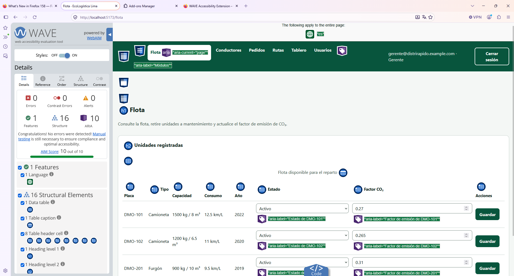
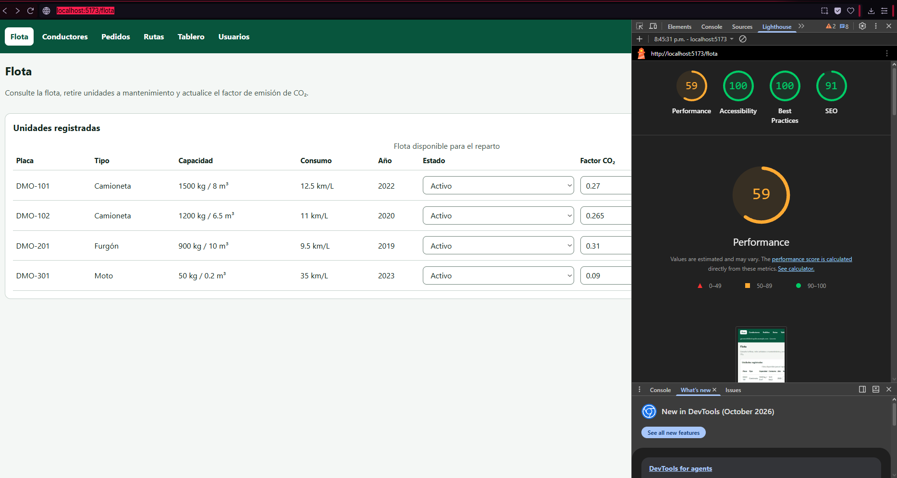
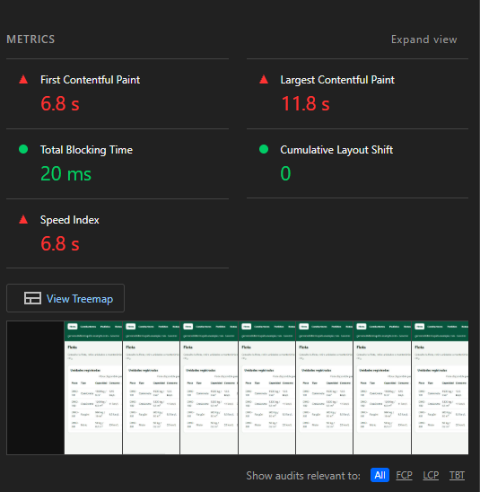
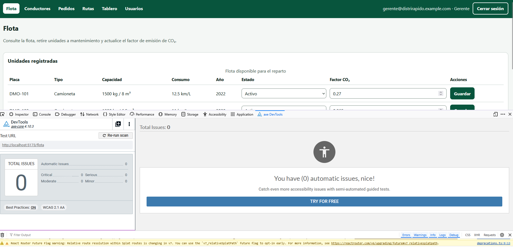

[← Volver al README Principal](../../../README.md)

# Evaluación de Accesibilidad Web (WCAG)

**Nombre del Proyecto:** EcoLogística Lima  
**Nivel de Conformidad Objetivo:** WCAG 2.2 Nivel AA  
**Herramientas Utilizadas:** Lighthouse / axe DevTools / WAVE, más axe-core en Vitest

El nombre completo del proyecto es EcoLogística Lima – Optimizador de Rutas Sostenibles para DistriRápido S.A.C. Fecha de la evaluación: 2026-10-28. Versión del análisis: V_1_0_0. El acta de constitución cita WCAG 2.1 AA. Este entregable evalúa 2.2 AA, que conserva ese conjunto y añade 2.4.11, 2.5.7, 2.5.8, 3.2.6, 3.3.7 y 3.3.8. El criterio 4.1.1 (Parsing) se retiró en WCAG 2.2 y no entra en los 55 criterios A+AA.

## 1. Resumen de Accesibilidad por Principios

El universo son los 55 criterios A y AA de WCAG 2.2. Por principio hay 20 de Perceptible, 20 de Operable, 13 de Comprensible y 2 de Robusto. El porcentaje es criterios que cumplen dividido entre criterios aplicables, por 100. Del denominador salen los que no aplican porque ese tipo de contenido no existe. Un criterio no se cuenta como fallo previo si el producto ya cumplía el mínimo y el cambio solo lo reforzó (el zoom de Leaflet medía 26 px y 2.5.8 pide 24 px). Nombre, rol y estado se dan por cumplidos cuando axe-core no reporta violaciones y el árbol de accesibilidad los expone.

- **Perceptible:** Antes 50 % (7/14). Después 100 % (14/14). No aplican 6: 1.2.1 a 1.2.5 y 1.4.2, porque no hay audio ni vídeo. Antes fallaban la alternativa del mapa (1.1.1), las tablas y los indicadores (1.3.1), el orden de la ficha de ruta (1.3.2), la ruta elegida marcada solo en el dibujo (1.4.1), el placeholder (1.4.3), el reflow a 320 px (1.4.10) y el foco del mismo verde que la barra (1.4.11). Esos puntos quedaron corregidos. 1.4.5 cumple porque el texto es texto, no una imagen. La paleta compartida supera 4.5:1; la captura WAVE del resto de pantallas, después del cambio, sigue pendiente y no se trata como un fallo abierto.
- **Operable:** Antes 62.5 % (10/16). Después 100 % (16/16). No aplican 4: 2.1.4 (no hay atajos de una letra), 2.2.1 (no hay límite de tiempo en la página), 2.2.2 (no hay movimiento automático) y 2.5.4 (no hay funciones por movimiento del dispositivo). Antes fallaban el teclado en el desplazamiento de las tablas y en el mapa (2.1.1), el salto que no movía el foco (2.4.1), el título del login y del acceso denegado (2.4.2), una sola vía para llegar a los módulos (2.4.5), encabezados o botones repetidos (2.4.6) y el foco invisible sobre la barra (2.4.7). 2.5.8 ya cumplía y se dejó en 44 px. La recorrida visual con teclado, pantalla por pantalla, la confirma el equipo; el indicador está en la hoja global.
- **Comprensible:** Antes 81.8 % (9/11). Después 100 % (11/11). No aplican 2: 3.2.6 (no hay un mecanismo de ayuda) y 3.3.4 (no hay un compromiso legal ni un pago). Antes fallaban el idioma de los controles del mapa, en inglés (3.1.2), y el cambio de fecha o de rol sin un aviso previo (3.2.2). 3.3.3 ya mostraba en texto la sugerencia que devuelve el API.
- **Robusto:** Antes 50 % (1/2). Después 100 % (2/2). Ninguno es N/A. 4.1.2 fallaba: varios botones se llamaban igual y el zoom del mapa no tenía nombre en español. Después, axe-core 4.10.3 reporta 0 violaciones de nombre, rol y valor, y el árbol de accesibilidad expone placa, correo, ruta y los botones Acercar y Alejar. 4.1.3 ya cumplía: el error está en `role="alert"` y el acierto en `<output>`, ambos con rol de estado en el árbol de accesibilidad.

En conjunto, de 43 criterios aplicables, cumplían 27 antes (62.8 %) y 43 después (100 %). Los 12 restantes son N/A. 6 + 4 + 2 = 12, y 43 + 12 = 55.

## 2. Hallazgos Principales y Correcciones

| Criterio de Conformidad | Problema Detectado | Componente Afectado | Solución Aplicada |
|---|---|---|---|
| 1.1.1 Contenido no textual | El mapa no tenía una alternativa textual asociada. La tabla de paradas existía, pero el mapa no la referenciaba | Mapa Leaflet en Rutas | Lista «Alternativa textual del mapa» (partida, paradas, ETA y semáforo en palabras), enlazada con `aria-describedby` |
| 1.3.1 Información y relaciones | Encabezados de tabla sin `scope`. Los indicadores del tablero eran un `span` y un `strong`. El acceso denegado no tenía encabezado | Tablas de Flota, Conductores, Pedidos, Usuarios y Rutas; Tablero; acceso denegado | `scope="col"`, `h2`/`h3` en el tablero y `h1` «Acceso denegado» |
| 1.3.2 Secuencia significativa | El botón «Ver en el mapa» estaba antes del encabezado de la ruta | Ficha de cada ruta | Primero el `h3` con vehículo y conductor, después la acción |
| 1.4.1 Uso del color | La ruta seleccionada solo se notaba en el dibujo del mapa | Rutas | El botón pasa a «Visible en el mapa» y expone `aria-pressed`. El semáforo ya llevaba el texto Verde, Amarillo o Rojo |
| 1.4.3 Contraste (mínimo) | El placeholder «frente a la bodega El Ahorro» heredaba el gris del navegador, por debajo de 4.5:1. El resto de la paleta sí cumplía | Campo punto de referencia en Pedidos | `::placeholder` en `#3d5248` (8.40:1 sobre blanco) |
| 1.4.10 Reflow | A 320 px un correo largo impedía que el campo encogiera y la página medía 343 px. Una tabla ancha podía empujar toda la página | Login y tablas de los módulos | `min-width: 0` en tarjeta, etiquetas y campos. El scroll horizontal queda dentro de la tabla |
| 1.4.11 Contraste no textual | El anillo de foco usaba `#08553d`, el mismo verde de la barra (contraste 1:1) | Barra de módulos | Anillo doble: 3 px blancos y 3 px `#10241c`. El blanco contrasta 8.83:1 con la barra |
| 2.1.1 Teclado | La tabla ancha se desplazaba en un contenedor fuera del tabulador. La rueda del mapa hacía zoom aunque el mapa no tuviera el foco y se comía el scroll de la página | Tablas de los módulos y mapa de Rutas | Botones «Desplazar la tabla a la izquierda» y «a la derecha». El zoom con rueda solo actúa con el foco. Escape suelta el mapa |
| 2.4.1 Evitar bloques | «Saltar al contenido» existía, pero el destino no recibía el foco | Shell de las pantallas autenticadas | El destino es el enlace «Contenido principal». Enter lo enfoca. Permanece oculto hasta recibir el foco |
| 2.4.2 Página titulada | El login dejaba el título genérico. El acceso denegado conservaba el título de la pantalla anterior | Login y módulo sin permiso | «Iniciar sesión · EcoLogística Lima» y «Acceso denegado · EcoLogística Lima» |
| 2.4.5 Múltiples vías | La única lista de módulos era la barra | Navegación autenticada | Pie «Accesos directos» con los módulos del rol, en otro `nav` |
| 2.4.6 Encabezados y etiquetas | «Guardar», «Activar», «Desactivar», «Ver en el mapa» y «Confirmar ruta» se repetían sin decir de qué fila se trataba | Flota, Usuarios y Rutas | El nombre accesible añade placa, correo o vehículo y conductor. El texto visible sigue dentro de ese nombre |
| 2.4.7 Foco visible | Sobre la barra verde el foco no se distinguía | Barra de módulos | El mismo anillo doble de 1.4.11, definido en `:focus-visible` para toda la interfaz |
| 2.5.8 Tamaño del objetivo (mínimo) | El zoom de Leaflet medía 26 px y los campos de la tabla 36 px. Cumplían los 24 px del criterio, pero el anillo chocaba con el botón vecino | Controles de zoom y celdas editables | Mínimo de diseño 44×44 px y 6 px entre Acercar y Alejar. No se contó como incumplimiento previo |
| 3.1.2 Idioma de las partes | Los controles del mapa se llamaban «Zoom in» y «Zoom out» en una página en español | Mapa Leaflet | Nombres y `title` en español: Acercar y Alejar |
| 3.2.2 Al recibir entradas | Cambiar la fecha recargaba el plan o el tablero. Cambiar el rol guardaba en el acto, sin aviso previo | Rutas, Tablero y Usuarios | Texto visible antes del control. El selector de rol lo referencia con `aria-describedby` |
| 3.3.8 Autenticación accesible (mínimo) | El login ya permitía pegar y usaba `autocomplete` de usuario y contraseña actual. La clave de un usuario nuevo no se declaraba como contraseña nueva | Alta de usuario | `autoComplete="new-password"`. No hay captcha ni prueba cognitiva |
| 4.1.2 Nombre, función, valor | El mismo hueco de 2.4.6: controles con el mismo nombre y zoom sin nombre útil | Botones de fila y controles del mapa | Nombres únicos en el árbol de accesibilidad. axe-core 4.10.3 queda en 0 violaciones |
| 4.1.3 Mensajes de estado | El `role="alert"` ya existía. El foco del teclado no llegaba al mensaje | Avisos de error de todas las pantallas | El error es un enlace dentro del aviso y recibe el foco al aparecer. El acierto sigue en `<output>`, con rol de estado en el árbol de accesibilidad |

## 3. Alcance y metodología

### Pantallas

| Pantalla | Ruta | Quién la ve |
|---|---|---|
| Iniciar sesión | `/login` | Sin sesión |
| Flota | `/flota` | Todos los roles autenticados. El conductor y el auditor consultan; administrador, gerente y operador editan |
| Conductores | `/conductores` | Administrador, gerente, operador y auditor |
| Pedidos | `/pedidos` | Administrador, gerente, operador y auditor |
| Rutas (mapa Leaflet) | `/rutas` | Administrador, gerente, operador y auditor |
| Tablero | `/dashboard` | Administrador, gerente, operador y auditor |
| Usuarios | `/usuarios` | Administrador (escribe) y gerente (consulta) |
| Modo conductor | `/modo` | Conductor |
| Acceso denegado | cualquier módulo fuera del rol | Por ejemplo, el conductor en `/usuarios` |

### Herramientas

| Herramienta | Uso en esta evaluación |
|---|---|
| axe-core 4.10.3 | Mismo motor que axe DevTools 4.10.3. Corre en Vitest (jsdom) sobre las nueve superficies, con las etiquetas `wcag2a`, `wcag2aa`, `wcag21a`, `wcag21aa` y `wcag22aa`. Entra en `npm test` y, por tanto, en la CI |
| axe DevTools 4.10.3 | Línea base manual de Flota en el equipo, WCAG 2.1 AA, 0 issues. Captura en la sección 4 |
| WAVE | Línea base manual de Flota: 0 errores, 0 errores de contraste, 0 alertas, AIM 10/10 |
| Lighthouse | Línea base manual de Flota: Accessibility 100, Best Practices 100, SEO 91, Performance 59 |
| Revisión de código | Teclado, foco, etiquetas, tablas, mapa, zoom y tamaño de objetivo |
| Chrome headless sobre `npm run build` | Orden de tabulador, enlace «Saltar al contenido», reflow a 320 px y zoom 200 % con el espaciado de texto de la técnica WCAG 1.4.12 |

La regla `color-contrast` de axe queda apagada en jsdom: ahí no hay diseño real y el resultado sería falso. El contraste se revisó con la paleta calculada y con la captura WAVE de Flota. La regla `target-size` (2.5.8) viene desactivada de fábrica en axe-core 4.10.3; el tamaño se revisó en CSS (mínimo 44 px) y en el código de Leaflet. La consigna pide Lighthouse, axe DevTools y WAVE. Esas tres, más axe-core en Vitest, son las de esta evaluación.

## 4. Línea base de la pantalla Flota

Capturas tomadas en el equipo sobre `http://localhost:5173/flota`, con el servidor de desarrollo de Vite, antes de las correcciones de este documento. Sirven de línea base de Flota. No son el estado posterior al cambio: el pie de accesos directos, la alternativa textual del mapa y los botones de desplazamiento de las tablas se agregan después. La sección 8 pide las capturas nuevas.

WAVE: 0 errores, 0 errores de contraste, 0 alertas, 1 feature (idioma), 16 elementos estructurales, 10 ARIA, AIM score 10/10.



Lighthouse: Accessibility 100, Best Practices 100, SEO 91, Performance 59.



Métricas de esa misma pasada: First Contentful Paint 6.8 s, Largest Contentful Paint 11.8 s, Total Blocking Time 20 ms, Cumulative Layout Shift 0, Speed Index 6.8 s. Esas cifras salen del servidor de desarrollo de Vite, no de `npm run build`. **Performance no es un criterio WCAG.** El 59 de rendimiento no baja el nivel AA. Accessibility 100 sí entra en esta evaluación.



axe DevTools 4.10.3, WCAG 2.1 AA: 0 issues automáticos.



Lo que esa pasada de una sola pantalla no ve, y la revisión del resto del sistema sí encontró: el anillo de foco del mismo verde que la barra, botones «Guardar», «Activar» y «Confirmar ruta» repetidos, el mapa sin alternativa textual enlazada, el título de la pestaña en el login y el desborde horizontal del formulario cuando el correo es largo y la ventana mide 320 px.

## 5. Detalle de las correcciones

La sección 2 resume el hallazgo y la solución. Esta tabla añade severidad, archivo y estado.

| Criterio | Pantalla | Descripción | Severidad | Corrección | Archivo | Estado |
|---|---|---|---|---|---|---|
| 2.4.7 Foco visible, 1.4.11 Contraste no textual | Barra de todas las pantallas autenticadas | El anillo usaba `#08553d`, el mismo verde del fondo. Sobre la barra el foco no se distinguía (contraste 1:1) | Alta | Anillo doble: 3 px blancos pegados al control y 3 px `#10241c` por fuera. El blanco contrasta 8.83:1 con la barra; el oscuro, 16:1 con el fondo claro | `frontend/src/styles.css` | Corregido |
| 2.4.1 Evitar bloques | Todas las autenticadas | Existía «Saltar al contenido», pero el destino `#contenido` no era enfocable: al activarlo el foco seguía en el enlace | Alta | El destino es un enlace real «Contenido principal». Enter lo enfoca. Está oculto hasta que recibe el foco, para no usar `tabIndex` en un elemento estático | `frontend/src/pages/Shell.tsx`, `styles.css` | Corregido |
| 2.4.6, 4.1.2, 2.5.3 Nombre del control | Flota, Usuarios, Rutas | Varios botones se llamaban igual: «Guardar», «Activar» / «Desactivar», «Ver en el mapa», «Confirmar ruta». El texto visible no decía de qué fila se trataba | Media | El nombre accesible añade placa, correo o vehículo y conductor. El texto visible sigue dentro de ese nombre | `FlotaPage.tsx`, `UsuariosPage.tsx`, `RutasPage.tsx` | Corregido |
| 1.1.1 Contenido no textual, 3.1.2 Idioma de un fragmento | Rutas | El mapa no apuntaba a un recorrido en texto. Los botones de Leaflet se llamaban «Zoom in» y «Zoom out» | Media | Lista «Alternativa textual del mapa» (partida, paradas, ETA y semáforo en palabras) referenciada con `aria-describedby`. Los controles quedan en «Acercar» y «Alejar» | `MapaRutas.tsx`, `RutasPage.tsx` | Corregido |
| 2.1.1 Teclado, 2.1.2 Sin trampa, 2.5.7 Arrastrar | Rutas | La rueda del mouse hacía zoom aunque el mapa no tuviera el foco y se comía el scroll de la página. No había forma explícita de soltar el mapa | Media | El zoom con rueda solo se enciende con el foco y se apaga al salir. Escape suelta el mapa. Las flechas de Leaflet y la tabla siguen siendo la alternativa al arrastre | `MapaRutas.tsx` | Corregido |
| 1.4.10 Reflow | Login y tablas | A 320 px de ancho el correo largo impedía que el campo encogiera y la página crecía a 343 px. El grid de las tablas podía empujar el ancho de toda la página | Media | `min-width: 0` en tarjeta, etiquetas y campos. El scroll horizontal queda dentro de la tabla. Comprobado en Chrome sobre el build: login, Flota, Conductores, Pedidos, Rutas, Tablero y Usuarios quedan en 320/320 | `styles.css` | Corregido |
| 2.1.1 Teclado en la tabla | Flota, Conductores, Pedidos, Usuarios, Rutas | La tabla ancha se desplaza en un contenedor que el teclado no alcanzaba | Media | Botones «Desplazar la tabla a la izquierda» y «Desplazar la tabla a la derecha», con el nombre de la tabla en el nombre accesible. Son botones nativos, sin `tabIndex` en un `div` | `frontend/src/avisos.tsx` | Corregido |
| 3.3.1 Identificación del error, 4.1.3 Mensajes de estado | Login y todos los módulos | El `role="alert"` ya existía. El foco no se movía al mensaje, así que quien usa solo teclado no aterrizaba en él | Media | El mensaje es un enlace dentro del aviso. Al aparecer, recibe el foco. El texto del enlace es el error. El acierto sigue en `<output>` (región viva, sin robar el foco de un selector) | `avisos.tsx` y páginas | Corregido |
| 2.4.2 Página titulada | Login y acceso denegado | El login dejaba el título genérico. Si el rol no entra al módulo, el título seguía siendo el de la pantalla anterior | Baja | «Iniciar sesión · EcoLogística Lima» y «Acceso denegado · EcoLogística Lima» | `LoginPage.tsx`, `App.tsx` | Corregido |
| 1.3.1, 2.4.6 Encabezados | Acceso denegado, Tablero, regiones | El rechazo de permiso era un párrafo suelto. Los indicadores eran `span` y `strong` sin encabezado | Baja | `h1` «Acceso denegado». En el tablero, `h2` «Período» e «Indicadores del día», y cada cifra en un `h3` dentro de un `article` con nombre | `App.tsx`, `DashboardPage.tsx` | Corregido |
| 1.3.1 Tablas | Todas las tablas | Los `th` no declaraban `scope` | Baja | `scope="col"` en cada encabezado. Las captions se mantienen | Páginas de listado | Corregido |
| 1.4.1 Uso del color, 4.1.2 Estado | Rutas | La ruta elegida solo se notaba en el dibujo del mapa | Baja | El botón pasa a «Visible en el mapa» y `aria-pressed`. El semáforo ya tenía el texto Verde, Amarillo o Rojo, no solo el color | `RutasPage.tsx` | Corregido |
| 1.3.2 Secuencia | Rutas | «Ver en el mapa» estaba antes del encabezado de la ruta | Baja | Primero el `h3` con vehículo y conductor, después la acción | `RutasPage.tsx` | Corregido |
| 2.4.5 Múltiples vías | Autenticadas | La única lista de módulos era la barra | Baja | El pie «Accesos directos» repite los módulos del rol, con otro `nav` y otro nombre | `Shell.tsx` | Corregido |
| 3.2.2 Al introducir datos | Rutas, Tablero, Usuarios | Cambiar la fecha recarga el plan o los indicadores. Cambiar el rol guarda en el acto | Baja | Un texto visible, antes del control, avisa de ese comportamiento. El selector de rol lo referencia con `aria-describedby` | `RutasPage.tsx`, `DashboardPage.tsx`, `UsuariosPage.tsx` | Corregido |
| 2.5.8 Tamaño del objetivo | Barra, tablas, zoom del mapa | Los controles de formulario ya medían 44 px. Los de la tabla medían 36 px y el zoom de Leaflet 26 px. 26 px cumple el mínimo de 24 px, pero el anillo de foco chocaba con el botón de al lado | Baja | Nav, campos de tabla y botones quedan en 44 px como mínimo. El zoom de Leaflet pasa a 44×44 px con 6 px de separación. No baja el porcentaje previo de la sección 1 | `styles.css` | Corregido |
| 1.4.3 Contraste del placeholder | Pedidos | El único placeholder («frente a la bodega El Ahorro») heredaba el gris del navegador, que a menudo no llega a 4.5:1 | Baja | `::placeholder` en `#3d5248` (8.40:1 sobre blanco) | `styles.css` | Corregido |
| 1.3.5 Propósito del campo, 3.3.8 Autenticación accesible | Login y alta de usuario | El login ya tenía `autocomplete="username"` y `current-password`, y no bloquea el pegado. La contraseña inicial de un usuario nuevo no decía que es una clave nueva | Baja | `autoComplete="new-password"` en el alta. No hay captcha ni prueba cognitiva. 1.3.5 del login ya cumplía y no entra como fallo previo | `LoginPage.tsx`, `UsuariosPage.tsx` | Corregido |
| 2.4.11 Foco no oculto | Todas | La barra no es fija ni sticky, así que el criterio ya se cumplía. Un foco al borde de la ventana podía quedar pegado al límite | Baja | `scroll-margin: 0.75rem` en `:focus-visible`. No se fijó la barra. No baja el porcentaje previo de la sección 1 | `styles.css` | Corregido |

Contraste de la paleta, texto normal (umbral AA 4.5:1) y componentes (umbral 3:1):

| Par | Ratio | Uso |
|---|---|---|
| `#10241c` sobre `#ffffff` | 16.26 | Texto principal |
| `#3d5248` sobre `#ffffff` | 8.40 | Texto secundario y placeholder |
| `#3d5248` sobre `#f4f7f5` | 7.79 | Ayuda sobre el fondo de página |
| `#ffffff` sobre `#08553d` | 8.83 | Barra, botón primario y enlace de salto |
| `#08553d` sobre `#ffffff` | 8.83 | Enlace del pie y página actual de la barra |
| `#7a1b1b` sobre `#fdecec` | 9.19 | Error |
| `#0d5c32` sobre `#e7f6ee` | 7.25 | Éxito y semáforo verde |
| `#6a4b00` sobre `#fff6df` | 7.44 | Aviso y semáforo amarillo |
| `#0b3a66` sobre `#e7f0fa` | 10.07 | Estado Asignado |
| `#6d8178` sobre `#ffffff` | 4.15 | Borde de campos (pasa 3:1, no es texto) |

## 6. Resultado después de las correcciones

- Vitest 2.1.9: **64 pruebas en verde**, 9 de ellas de axe-core 4.10.3 (login, Flota con tabla, Conductores, Pedidos, Rutas con mapa y alternativa textual, Tablero, Usuarios, Modo conductor y acceso denegado). Violaciones: **0**.
- Cobertura `@vitest/coverage-v8` 2.1.9 sobre `frontend/src`: **99.58 %** de líneas y **90.65 %** de ramas.
- `npm run build` (`tsc --noEmit` y Vite) termina sin errores.
- Chrome headless sobre el build de producción:
  - el primer elemento enfocable de Flota es «Saltar al contenido»; Enter deja el foco en «Contenido principal»;
  - a 320 px de ancho no hay scroll horizontal en login, Flota, Conductores, Pedidos, Rutas, Tablero ni Usuarios;
  - con zoom CSS 200 % y el espaciado de la técnica 1.4.12 (interlineado 1.5, tracking 0.12 em, word-spacing 0.16 em, margen de párrafo 2 em), login y Flota siguen en 1280/1280 y el `h1` permanece.

La CI (`.github/workflows/ci.yml`) ejecuta `npm test` y `npm run build` en el job del frontend. No hizo falta tocar el workflow: las pruebas de axe viven junto al resto.

## 7. Checklist de criterios A y AA

Esta lista es la base de la sección 1. «No aplica» sale del denominador. «Cumple» entra en el numerador de después. Donde el antes era distinto, la sección 1 lo cuenta.

| Criterio | Resultado |
|---|---|
| 1.1.1 Contenido no textual | Cumple después de la corrección. Antes no: el mapa no tenía alternativa asociada. La lista queda en el árbol, referenciada con `aria-describedby` |
| 1.2.1 Audio solo y vídeo solo (grabado) | No aplica. No hay audio ni vídeo |
| 1.2.2 Subtítulos (grabados) | No aplica. No hay audio ni vídeo |
| 1.2.3 Audiodescripción o alternativa | No aplica. No hay audio ni vídeo |
| 1.2.4 Subtítulos (en directo) | No aplica. No hay audio ni vídeo |
| 1.2.5 Audiodescripción (grabada) | No aplica. No hay audio ni vídeo |
| 1.3.1 Información y relaciones | Cumple después de la corrección. Antes no: tablas, indicadores y acceso denegado |
| 1.3.2 Secuencia significativa | Cumple después de la corrección. Antes no: el botón precedía al encabezado de la ruta |
| 1.3.3 Características sensoriales | Cumple. El semáforo y la ruta elegida no dependen solo del color o de la forma. El refuerzo de `aria-pressed` está en 1.4.1 |
| 1.3.4 Orientación | Cumple. No se bloquea la orientación |
| 1.3.5 Identificar el propósito del campo | Cumple. El login ya tenía `autocomplete`. El alta de otra persona no recoge datos de quien llena el formulario |
| 1.4.1 Uso del color | Cumple después de la corrección. Antes no: la ruta elegida solo se veía en el mapa |
| 1.4.2 Control del audio | No aplica. No hay audio |
| 1.4.3 Contraste (mínimo) | Cumple después de la corrección del placeholder. La paleta ya pasaba. La captura WAVE del resto de pantallas está pendiente |
| 1.4.4 Cambio de tamaño del texto | Cumple. Sin `maximum-scale`. Zoom 200 % comprobado en Chrome sobre login y Flota |
| 1.4.5 Imágenes de texto | Cumple. No hay imágenes de texto; el texto es texto |
| 1.4.10 Reflow | Cumple después de la corrección. Antes no: el login llegaba a 343 px |
| 1.4.11 Contraste no textual | Cumple después de la corrección. Antes no: el foco sobre la barra |
| 1.4.12 Espaciado del texto | Cumple en la prueba de Chrome (login y Flota) con la hoja de la técnica. El resto usa la misma CSS |
| 1.4.13 Contenido en hover o foco | Cumple. Los popups del mapa se abren al pulsar. El `title` nativo queda en el navegador |
| 2.1.1 Teclado | Cumple después de la corrección. Antes no: la tabla ancha y la rueda del mapa |
| 2.1.2 Sin trampa de teclado | Cumple. Tab sale del mapa. Escape lo suelta. Antes no había una trampa de teclado; la rueda no es teclado |
| 2.1.4 Atajos de un carácter | No aplica. No hay atajos de una sola letra. Las flechas solo actúan con el mapa enfocado |
| 2.2.1 Tiempo ajustable | No aplica. No hay un límite de tiempo en la página. El bloqueo de 15 minutos es una respuesta del servidor |
| 2.2.2 Pausar, detener, ocultar | No aplica. No hay movimiento automático |
| 2.3.1 Tres destellos | Cumple. Nada destella |
| 2.4.1 Evitar bloques | Cumple después de la corrección. Antes no: el salto no movía el foco |
| 2.4.2 Página titulada | Cumple después de la corrección. Antes no: login y acceso denegado |
| 2.4.3 Orden del foco | Cumple. Salto, módulos, sesión, contenido, pie |
| 2.4.4 Propósito de los enlaces | Cumple. Los enlaces dicen el módulo |
| 2.4.5 Múltiples vías | Cumple después de la corrección. Antes no: solo la barra |
| 2.4.6 Encabezados y etiquetas | Cumple después de la corrección. Antes no: botones repetidos y acceso denegado sin `h1` |
| 2.4.7 Foco visible | Cumple después de la corrección, por la hoja global y el contraste calculado. Antes no: el anillo se perdía en la barra. La recorrida visual pantalla por pantalla está pendiente |
| 2.4.11 Foco no oculto (mínimo) | Cumple antes y después. La barra no es fija. `scroll-margin` es un refuerzo |
| 2.5.1 Gestos del puntero | Cumple. El pellizco del mapa tiene botones Acercar y Alejar |
| 2.5.2 Cancelación del puntero | Cumple. Se usan `click` y `submit`, que disparan al soltar |
| 2.5.3 Etiqueta en el nombre | Cumple antes y después. El texto visible ya estaba dentro del nombre; el problema de botones iguales es 2.4.6 y 4.1.2 |
| 2.5.4 Actuación por movimiento | No aplica. No hay funciones que dependan del movimiento del dispositivo |
| 2.5.7 Movimientos de arrastre | Cumple. El mapa se mueve con flechas y la información está en la tabla |
| 2.5.8 Tamaño del objetivo (mínimo) | Cumple antes y después. 26 px y 36 px ya superaban 24 px. El diseño quedó en 44 px |
| 3.1.1 Idioma de la página | Cumple. `<html lang="es">` |
| 3.1.2 Idioma de las partes | Cumple después de la corrección. Antes no: «Zoom in» y «Zoom out» |
| 3.2.1 Al recibir el foco | Cumple. Enfocar el mapa no cambia de página |
| 3.2.2 Al recibir entradas | Cumple después de la corrección. Antes no: la fecha y el rol cambiaban el contenido sin aviso |
| 3.2.3 Navegación coherente | Cumple. La barra y el pie están en el mismo lugar en cada módulo |
| 3.2.4 Identificación coherente | Cumple. Los controles con la misma función se nombran igual entre pantallas |
| 3.2.6 Ayuda consistente | No aplica. No hay un mecanismo de ayuda |
| 3.3.1 Identificación del error | Cumple antes y después. El texto del error ya identificaba el fallo. Mover el foco es un refuerzo de teclado, no el requisito del criterio |
| 3.3.2 Etiquetas o instrucciones | Cumple. Cada campo tiene etiqueta |
| 3.3.3 Sugerencia ante errores | Cumple cuando el API devuelve el detalle (ventana invertida, jornada de más de 8 h): el texto queda en el aviso |
| 3.3.4 Prevención de errores (legales, financieros) | No aplica. No hay compra ni compromiso legal |
| 3.3.7 Entrada redundante | Cumple. No se vuelve a pedir un dato ya capturado en la misma pantalla |
| 3.3.8 Autenticación accesible (mínimo) | Cumple. Sin prueba cognitiva. Se puede pegar la contraseña y usar un gestor. El login ya cumplía |
| 4.1.2 Nombre, función, valor | Cumple después de la corrección. axe-core 4.10.3 reporta 0 violaciones y el árbol expone los nombres de botones, selectores y mapa. Antes no |
| 4.1.3 Mensajes de estado | Cumple antes y después: `role="alert"` y `<output>` ya exponen el mensaje en el árbol de accesibilidad. El foco sobre el error es un refuerzo |

4.1.1 Parsing no figura: WCAG 2.2 lo retiró.

## 8. Capturas por pantalla

La línea base de Flota está en la sección 4. Falta la tanda posterior al cambio, una por pantalla, con WAVE, Lighthouse (Accessibility) y axe DevTools 4.10.3. **Pendiente: completar por el equipo.**

| Pantalla | WAVE | Lighthouse Accessibility | axe DevTools |
|---|---|---|---|
| Login | Pendiente: completar por el equipo | Pendiente: completar por el equipo | Pendiente: completar por el equipo |
| Flota | Línea base en la sección 4. Repetir después del cambio | Línea base en la sección 4. Repetir después del cambio | Línea base en la sección 4. Repetir después del cambio |
| Conductores | Pendiente: completar por el equipo | Pendiente: completar por el equipo | Pendiente: completar por el equipo |
| Pedidos | Pendiente: completar por el equipo | Pendiente: completar por el equipo | Pendiente: completar por el equipo |
| Rutas, con al menos un plan y el mapa | Pendiente: completar por el equipo | Pendiente: completar por el equipo | Pendiente: completar por el equipo |
| Tablero | Pendiente: completar por el equipo | Pendiente: completar por el equipo | Pendiente: completar por el equipo |
| Usuarios | Pendiente: completar por el equipo | Pendiente: completar por el equipo | Pendiente: completar por el equipo |
| Modo conductor | Pendiente: completar por el equipo | Pendiente: completar por el equipo | Pendiente: completar por el equipo |
| Acceso denegado (conductor en Usuarios) | Pendiente: completar por el equipo | Pendiente: completar por el equipo | Pendiente: completar por el equipo |

Sugerencia de nombre al guardarlas en `docs/03 Implementación/Sprint 03/img/`: `wave-login.png`, `lighthouse-rutas.png`, `axe-usuarios.png`, y el mismo patrón para el resto.

## 9. Recomendación futura

Una pasada voluntaria con un lector de pantalla serviría para oír los nombres y los avisos. No la pide la consigna y no queda pendiente: 4.1.2 y 4.1.3 se cierran con axe-core 4.10.3 (0 violaciones) y con el árbol de accesibilidad.

## 10. Cómo repetir la prueba en Windows

Repositorio en `C:\xampp\htdocs\PFA-taller`. Hace falta Node.js 20 o superior. Los comandos son de PowerShell.

```powershell
cd C:\xampp\htdocs\PFA-taller\frontend
npm install
npm test
npx vitest run --coverage
npm run build
npm run dev
```

`npm test` incluye las nueve pruebas de axe-core 4.10.3. Con el servidor en marcha, abra http://localhost:5173 e inicie sesión con un usuario de demostración.

Para las capturas de la sección 8, en cada ruta:

1. WAVE (extensión). Anote errores, contrastes y alertas.
2. Lighthouse, modo Navegación, categoría Accessibility. El rendimiento medido con `npm run dev` no es un criterio WCAG: si hace falta una cifra de Performance, use `npm run build` y `npm run preview`.
3. axe DevTools 4.10.3. En el filtro elija WCAG 2.1 AA y, si la extensión lo ofrece, WCAG 2.2 AA.

[← Volver al README Principal](../../../README.md)
