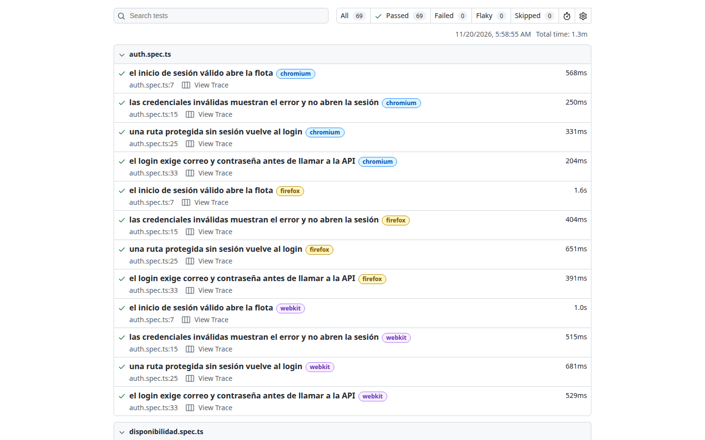
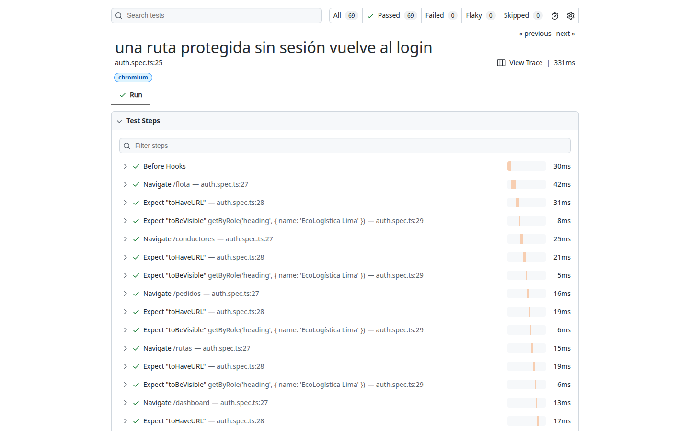
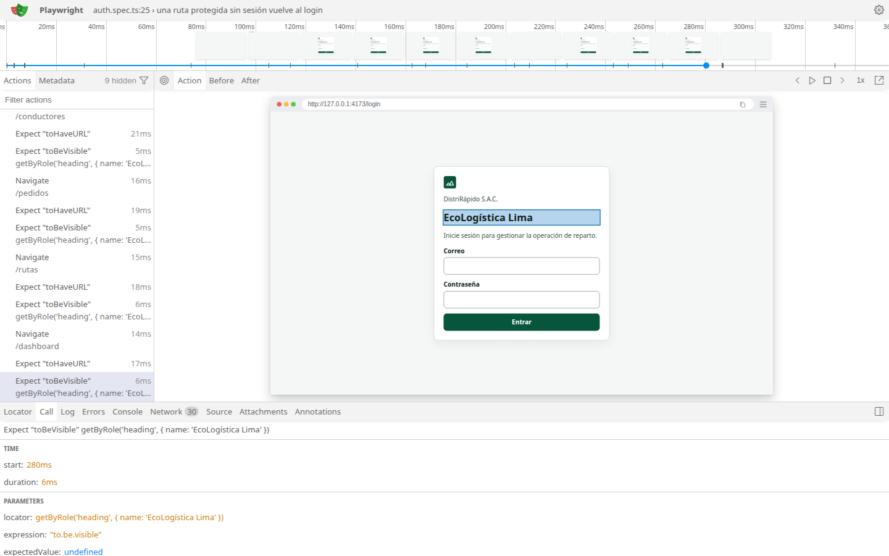

[← Volver al README principal](../../../README.md)

# Análisis de pruebas End-to-End con Playwright

**Nombre del Proyecto:** EcoLogística Lima – Optimizador de Rutas Sostenibles para DistriRápido S.A.C.  
**Fecha de la medición:** 2026-11-20  
**Versión del análisis:** V_1_0_1  
**Herramienta:** Playwright Test 1.65.1 (Chromium, Firefox y WebKit)

La medición se hizo sobre la pila local: PostgreSQL 16.15 con PostGIS 3.4.2, Redis 7.0, uvicorn (`app.main:app` en `127.0.0.1:8000`), el worker `python -m app.worker` y el preview de producción del frontend (`vite preview` en `http://127.0.0.1:4173`, con el mismo proxy de API que el servidor de desarrollo). El informe HTML de esa corrida marca **69 pasadas, 0 fallidas, 0 inestables y 0 omitidas**, en 1.3 minutos. La misma suite queda en el workflow `Tests` para repetirse en GitHub Actions.

## 1. Configuración del entorno de pruebas

### 1.1 Arquitectura de carpetas

```text
frontend/
  playwright.config.ts
  e2e/
    helpers.ts
    auth.spec.ts
    flujos.spec.ts
    formularios.spec.ts
    disponibilidad.spec.ts
    rendimiento.spec.ts
    produccion.spec.ts         # solo con E2E_PRODUCCION=1; no corre en CI
  .gitignore                 # playwright-report/, test-results/, blob-report/
.github/workflows/
  ci.yml                     # estilo, estático, build y dependencias
  tests.yml                  # pytest, vitest, integración HTTP y Playwright
backend/scripts/
  comprobar_integracion.py   # API ya arrancada: salud, login, listado y 422
docs/03 Implementación/Sprint 4/
  03 Analisis PlayWrigth V_1_0_1.md
  img/
```

`frontend/playwright-report/`, `frontend/test-results/` y `frontend/blob-report/` no se versionan. La misma exclusión está en el `.gitignore` de la raíz. El script `npm run test` sigue siendo Vitest; la suite E2E se lanza con `npm run test:e2e` dentro de `frontend/`.

### 1.2 Navegadores y `playwright.config.ts`

Hay un proyecto por motor: Chromium (Desktop Chrome), Firefox (Desktop Firefox) y WebKit (Desktop Safari). Los tres usan `locale: es-PE` y `timezoneId: America/Lima`, para que la fecha del tablero y los mensajes nativos de formulario no dependan de la zona UTC del runner. Un solo worker recorre los proyectos en serie: la base de demostración es compartida y el login con bcrypt no debe competir consigo mismo.

La traza se conserva en el fallo cuando corre en CI (`retain-on-failure`). Fuera de CI se graba siempre (`trace: "on"`), que es de donde salen las capturas de este informe. La captura de pantalla queda en `only-on-failure`. El reporter HTML escribe en `frontend/playwright-report/` y no abre el navegador al terminar.

Si la variable `PLAYWRIGHT_BASE_URL` está definida, Playwright no levanta nada: apunta al servidor que ya existe (por ejemplo el servicio `web` de Docker Compose en el puerto 5173). Si no está definida, `webServer` compila el frontend y sirve el preview:

```ts
const baseURL = process.env.PLAYWRIGHT_BASE_URL ?? "http://127.0.0.1:4173";
const servidorExterno = Boolean(process.env.PLAYWRIGHT_BASE_URL);

export default defineConfig({
  testDir: "./e2e",
  workers: 1,
  reporter: [
    ["list"],
    ["html", { outputFolder: "playwright-report", open: "never" }],
  ],
  projects: [
    { name: "chromium", use: { ...devices["Desktop Chrome"] } },
    { name: "firefox", use: { ...devices["Desktop Firefox"] } },
    { name: "webkit", use: { ...devices["Desktop Safari"] } },
  ],
  webServer: servidorExterno
    ? undefined
    : {
        command: "npm run build && npm run preview -- --host 127.0.0.1 --port 4173 --strictPort",
        url: baseURL,
        reuseExistingServer: !process.env.CI,
        timeout: 180_000,
      },
});
```

`frontend/vite.config.ts` declara el mismo `proxy` en `server` y en `preview`. Las navegaciones `GET` con `Accept: text/html` siguen sirviendo el SPA (`respuestaSpa`). El resto (`/auth`, `/vehiculos`, `/conductores`, `/pedidos`, `/clientes`, `/optimizaciones`, `/rutas`, `/indicadores`, `/health`, `/docs`, `/openapi.json`) se reenvía a `VITE_PROXY_TARGET`, por defecto `http://127.0.0.1:8000`.

En GitHub Actions el job `e2e` de `.github/workflows/tests.yml` levanta PostGIS `postgis/postgis:16-3.4` y Redis 7, migra con Alembic, siembra los usuarios de demostración, arranca uvicorn y el worker, instala Chromium, Firefox y WebKit con `npx playwright install --with-deps` y publica `frontend/playwright-report/` junto con `frontend/test-results/` como artefacto `playwright-report` (`actions/upload-artifact@v4`, 14 días).

`.github/workflows/ci.yml` sigue en `push` y `pull_request` hacia `main` y `develop`. El backend valida dependencias (`pip check`), estilo (`ruff check`), estático (`compileall`) y las pruebas con pytest. El frontend valida el lockfile (`npm ci`), corre Vitest y compila con `tsc --noEmit` más `vite build`.

## 2. Pruebas End-to-End (E2E)

Cada archivo se ejecutó una vez por navegador. El total es 23 casos × 3 navegadores.

| Navegador | Pasadas | Fallidas | Total |
|---|---:|---:|---:|
| Chromium | 23 | 0 | 23 |
| Firefox | 23 | 0 | 23 |
| WebKit | 23 | 0 | 23 |
| **Total** | **69** | **0** | **69** |

### 2.1 Autenticación

| Caso | Qué comprueba |
|---|---|
| Inicio de sesión válido | El administrador entra y la barra muestra su correo, el rol Administrador y el enlace Flota |
| Credenciales inválidas | Un correo inexistente deja la alerta «Credenciales inválidas» y la URL en `/login` |
| Ruta protegida | `/flota`, `/conductores`, `/pedidos`, `/rutas` y `/dashboard` sin sesión vuelven a `/login` |
| Campos obligatorios | Enviar el login vacío no llama a la API: el navegador exige el correo |

El caso de credenciales usa un correo que no existe, para no acumular intentos fallidos sobre la cuenta de demostración (el bloqueo llega al tercer fallo).

```ts
test("las credenciales inválidas muestran el error y no abren la sesión", async ({ page }) => {
  await page.goto("/login");
  await page.locator("#email").fill("nadie@distrirapido.example.com");
  await page.locator("#password").fill("clave-incorrecta");
  await page.getByRole("button", { name: "Entrar" }).click();
  await expect(page.locator("#alerta-login")).toContainText("Credenciales inválidas");
  await expect(page).toHaveURL(/\/login$/);
});
```

### 2.2 Flujos de negocio

| Módulo | Qué hace la prueba |
|---|---|
| Flota | La tabla de unidades carga, el listado autenticado contiene la placa de demostración `DMO-101`, se registra un vehículo y se actualiza su factor de emisión |
| Conductores | Desde el menú Módulos se abre el alta y queda un conductor con DNI nuevo |
| Pedidos | Se elige «Bodega El Ahorro — con consentimiento», se registra una entrega y la fila muestra distrito San Juan de Lurigancho, la referencia aproximada y el estado Pendiente |
| Rutas / optimización | El formulario, el mapa y el plan están visibles. Generar el plan del 2099-01-01 encola el trabajo; el worker lo cierra y la alerta dice «No hay pedidos pendientes» |
| Tablero | El período responde «Sin datos de operación para el período seleccionado.» al abrir y al pulsar Consultar |

La fecha 2099-01-01 aísla la optimización de los pedidos de demostración creados el mismo día. El worker y Redis están en marcha: el mensaje sale del job terminado, no de un tiempo de espera agotado.

### 2.3 Validación de formularios y HTTP 422

| Caso | Capa que responde |
|---|---|
| Placa vacía en flota | El navegador bloquea el envío (`validationMessage`) y no aparece alerta de API |
| Año 1800 en flota | El mínimo HTML se retira a propósito y la API responde 422: «año» |
| DNI de menos de 8 dígitos | El `pattern` del campo detiene el envío |
| Latitud 999 de conductor | HTTP 422 con el texto de latitud |
| Horario 18:00–08:00 | HTTP 422 con el texto de hora |
| Peso de pedido vacío | El navegador exige el peso |
| Ventana invertida | El cliente muestra «La ventana de inicio debe ser anterior a la ventana de fin.» |
| Cliente sin consentimiento | HTTP 422 con el texto de consentimiento |
| Latitud 999 de pedido | HTTP 422 con el texto de latitud |

El 422 de la API llega como `detail` ya traducido por `traducir_validacion` y la pantalla lo pinta en `role="alert"`.

## 3. Monitoreo de rendimiento

Un solo caso, `web vitals por pantalla y tiempos de API bajo 500 ms`, recorre las seis pantallas con una navegación completa (`page.goto`) y después mide la API desde la página, con `fetch` y `cache: "no-store"`. Cada endpoint se llama una vez de calentamiento y cinco veces más. La cifra que se compara con el umbral es la mediana. El tope de la prueba es 500 ms para TTFB y para cada mediana de API, 2 500 ms para FCP y 4 000 ms para LCP. Ninguna muestra se acercó a esos topes.

TTFB es `PerformanceNavigationTiming.responseStart`. FCP es la entrada `first-contentful-paint`. LCP sale de un `PerformanceObserver` de tipo `largest-contentful-paint` instalado antes de cada navegación.

### 3.1 Web Vitals por pantalla (ms)

| Pantalla | Chromium TTFB / FCP / LCP | Firefox TTFB / FCP / LCP | WebKit TTFB / FCP / LCP |
|---|---:|---:|---:|
| Login | 1.8 / 56 / 72 | 2 / 63 / 63 | 4 / 74 / 74 |
| Flota | 1.6 / 40 / 40 | 4 / 47 / 69 | 2 / 27 / 81 |
| Conductores | 1.5 / 48 / 48 | 3 / 57 / 101 | 1 / 46 / 92 |
| Pedidos | 1.4 / 40 / 60 | 3 / 44 / 89 | 1 / 28 / 82 |
| Rutas | 1.7 / 52 / 52 | 1 / 54 / 92 | 2 / 43 / 102 |
| Tablero | 1.3 / 24 / 44 | 5 / 54 / 73 | 1 / 28 / 85 |

El TTFB más alto fue 5 ms (Tablero en Firefox). El LCP más alto fue 102 ms (Rutas en WebKit). El preview sirve el HTML y el JS ya compilados en `127.0.0.1`, así que estas cifras son de laboratorio, no de una red móvil.

### 3.2 Tiempos de API (mediana / máximo, ms)

La medición incluye el proxy del preview y el cuerpo de la respuesta. Todas las medianas quedaron por debajo de 500 ms. El login es el caso lento: bcrypt al verificar la contraseña. El resto son lecturas o escrituras cortas sobre PostgreSQL local.

| Método y ruta | Estado | Chromium | Firefox | WebKit |
|---|---:|---:|---:|---:|
| POST `/auth/login` | 200 | 245 / 246 | 249 / 252 | 259 / 264 |
| GET `/health` | 200 | 3.4 / 4.0 | 5 / 5 | 3 / 4 |
| GET `/auth/me` | 200 | 3.7 / 4.7 | 5 / 6 | 4 / 5 |
| GET `/vehiculos?page=1&limite=12` | 200 | 5.0 / 5.7 | 6 / 7 | 5 / 5 |
| GET `/conductores?page=1&limite=12` | 200 | 5.2 / 5.6 | 6 / 7 | 5 / 6 |
| GET `/pedidos?page=1&limite=12` | 200 | 6.1 / 6.2 | 7 / 8 | 7 / 7 |
| GET `/clientes?page=1&limite=12` | 200 | 4.4 / 4.9 | 6 / 7 | 5 / 8 |
| GET `/rutas?fecha=2026-11-20&page=1&limite=12` | 200 | 4.7 / 5.1 | 6 / 8 | 5 / 6 |
| GET `/indicadores?fecha=2026-11-20` | 200 | 4.3 / 4.5 | 6 / 6 | 5 / 5 |
| GET `/usuarios?page=1&limite=12` | 200 | 4.5 / 5.0 | 5 / 6 | 5 / 5 |
| POST `/vehiculos` | 201 | 7.0 / 7.0 | 9 / 10 | 8 / 8 |
| PUT `/vehiculos/{id}` | 200 | 7.1 / 7.5 | 8 / 9 | 8 / 9 |

La mediana más alta de toda la tabla es 259 ms (login en WebKit). El máximo observado en login fue 264 ms. Las lecturas y el alta o la actualización de un vehículo quedaron entre 3.4 ms y 10 ms.

## 4. Disponibilidad y resiliencia

### 4.1 Códigos HTTP

Con la API y el preview en marcha, el caso de códigos comprueba:

| Petición | Código |
|---|---:|
| `GET /login` y las rutas de módulo con `Accept: text/html` | 200, y el HTML contiene `id="root"` |
| `GET /health` | 200 y `status: ok` |
| `GET /openapi.json` | 200 |
| `GET /vehiculos` sin token | 401 |
| `POST /auth/login` con credenciales inexistentes | 401 |
| `POST /auth/login` del administrador de demostración | 200 |
| `GET /vehiculos` con el token | 200 |
| `POST /conductores` con el horario invertido | 422 |

Las rutas `/conductores`, `/pedidos` y `/rutas` coinciden con prefijos de la API. El documento del navegador pide `text/html` y el proxy devuelve el SPA. Una petición JSON al mismo path, sin sesión, sigue siendo 401. El caso cubre las dos.

### 4.2 Fallos de red y de API en la interfaz

| Caso | Resultado en los tres navegadores |
|---|---|
| `GET /vehiculos` interceptado con HTTP 500 y `detail` «Fallo controlado de prueba» | La pantalla Flota sigue en pie y `#alerta-flota` muestra ese texto |
| `fetch` de `/conductores` abortado (`failed`), sin cortar el documento | `#alerta-conductores` muestra «No se pudo cargar los conductores.» |
| `POST /vehiculos` interceptado con HTTP 422 | `#alerta-flota` muestra «El año de fabricación no es válido» y el encabezado no desaparece |

El 500 y el corte de red no dejan la página en blanco: el módulo pinta el `role="alert"` y el resto del shell (barra, título) permanece.

### 4.3 Disponibilidad medida y staging

En esta corrida `GET /health` respondió 200 antes de abrir Playwright y otra vez dentro de la suite, en los tres navegadores. No hubo un 5xx originado por uvicorn, PostgreSQL o Redis: los 500 y los abortos de la sección 4.2 son interceptaciones del navegador. El plan del 2099-01-01 se encoló en Redis y el worker lo cerró con un mensaje de negocio.

Eso cubre la máquina local y el job de GitHub Actions (el workflow `Tests` repite PostGIS, Redis, uvicorn, el worker y los tres navegadores, y guarda el informe HTML). No es una cifra de disponibilidad de producción. La medición contra el sitio público está en la sección 5.

### 4.4 Informe HTML

El reporter dejó el resumen en `frontend/playwright-report/`. Estas tres capturas son de esa corrida (69/69, 20 de noviembre de 2026, 1.3 minutos).







## 5. Medición contra producción

Fecha de la medición: 2026-11-20, entre 20:33:00Z y 20:37:37Z, desde este entorno de integración. El sitio ya estaba desplegado a mano. `frontend/vercel.json` de este cambio todavía no está publicado: las cifras describen el sitio que responde hoy, no un despliegue de este pull request.

No había contraseña de demostración en el entorno (`SEED_ADMIN_PASSWORD` y equivalentes vacíos). No se inició sesión. No hay tiempos de un endpoint autenticado. Las cifras de abajo son solo de rutas públicas.

### 5.1 Web Vitals (Chromium, caché desactivada)

Una navegación por contexto, `Network.setCacheDisabled`, viewport 1280×800. `TTFB` es `responseStart` de `PerformanceNavigationTiming`. `FCP` es la entrada `first-contentful-paint`. `LCP` sale de un `PerformanceObserver` de `largest-contentful-paint`. Medido a las 20:37:37Z.

| Ruta pedida | HTTP | URL final | TTFB (ms) | FCP (ms) | LCP (ms) |
|---|---:|---|---:|---:|---:|
| `/login` | 200 | `/login` | 21.40 | 88 | 104 |
| `/` | 200 | `/login` | 20.30 | 80 | 116 |
| `/usuarios` | 200 | `/login` | 23.90 | 84 | 100 |

`/` y `/usuarios` entregaron el documento (200) y la SPA, sin sesión, terminó en `/login`. El documento transferido midió 2866 bytes en las tres navegaciones.

### 5.2 Tiempos de API (mediana de 5, un calentamiento descartado)

`fetch` con `cache: "no-store"` y `Accept: application/json`. El cuerpo se leyó completo. Cierre de la muestra: 20:35:46Z.

| URL | HTTP | Mediana (ms) | Máximo (ms) | Muestras (ms) |
|---|---:|---:|---:|---|
| `https://api-production-b8dfa3c0.up.railway.app/health` | 200 | 25.20 | 59.12 | 59.12, 25.20, 28.27, 23.58, 24.61 |
| `https://ecologistica-lima-beige.vercel.app/health` | 200 | 46.92 | 59.06 | 59.06, 55.57, 41.95, 46.92, 41.86 |
| `https://api-production-b8dfa3c0.up.railway.app/openapi.json` | 200 | 26.08 | 27.97 | 20.52, 23.61, 26.28, 26.08, 27.97 |

`/health` de la API devolvió `{"status":"ok","servicio":"ecologistica-api"}`.

### 5.3 Códigos HTTP (una petición cada uno, 20:37:37Z)

| Petición | Accept | HTTP | Tipo | ms | Bytes |
|---|---|---:|---|---:|---:|
| Vercel `GET /login` | `text/html` | 200 | `text/html; charset=utf-8` | 58.88 | 7177 |
| Vercel `GET /health` | `application/json` | 200 | `application/json` | 107.14 | 45 |
| Vercel `GET /openapi.json` | `application/json` | 200 | `application/json` | 58.63 | 32912 |
| Vercel `GET /docs` | `text/html` | 200 | `text/html; charset=utf-8` | 40.23 | 941 |
| Vercel `GET /usuarios` | `text/html` | 200 | `text/html; charset=utf-8` | 28.78 | 7177 |
| Vercel `GET /usuarios` | `application/json` | 401 | `application/json` | 33.21 | 27 |
| Railway `GET /health` | `application/json` | 200 | `application/json` | 55.23 | 45 |
| Railway `GET /docs` | `text/html` | 200 | `text/html; charset=utf-8` | 48.06 | 941 |

`/usuarios` con `text/html` devolvió el HTML de la SPA (`<!doctype html>`). La misma ruta con `application/json` devolvió `{"detail":"No autenticado"}`. `/docs` en los dos orígenes devolvió el HTML de Swagger (941 bytes).

### 5.4 Disponibilidad

12 peticiones, una cada 15 segundos, en paralelo, de 20:33:00.816Z a 20:35:46.815Z. Éxito: HTTP 200–399.

| URL | Éxitos | Porcentaje | Mínimo (ms) | Máximo (ms) |
|---|---:|---:|---:|---:|
| Railway `GET /health` | 12/12 | 100 | 21.69 | 399.82 |
| Vercel `GET /login` | 12/12 | 100 | 22.50 | 42.22 |

En Railway, la petición 9 tardó 399.82 ms y el resto quedó entre 21.69 ms y 76.40 ms. En Vercel las doce quedaron entre 22.50 ms y 42.22 ms. No hubo timeout ni código distinto de 200. Es una muestra de unos tres minutos, no un mes de disponibilidad.

### 5.5 Suite de solo lectura

`frontend/e2e/produccion.spec.ts` no entra en la suite de CI: `playwright.config.ts` lo ignora salvo que `E2E_PRODUCCION=1`. No crea ni borra datos. Comprueba el título de `/login`, `GET /health` 200, `GET /openapi.json` 200, `GET /usuarios` con HTML 200 y con JSON 401.

Corrida de esta medición, solo Chromium, contra `PLAYWRIGHT_BASE_URL=https://ecologistica-lima-beige.vercel.app`: **2 pasadas, 0 fallidas, 1.1 s**. No se apuntó el resto de la suite (crea vehículos, conductores y pedidos) a producción.

```bash
cd frontend
E2E_PRODUCCION=1 PLAYWRIGHT_BASE_URL=https://ecologistica-lima-beige.vercel.app \
  npx playwright test e2e/produccion.spec.ts --project=chromium
```

## Historial de Control de Cambios

| Versión | Fecha | Autor | Descripción |
|---|---|---|---|
| 1.0.0 | 20/11/2026 | Equipo EcoLogística Lima | Suite local: 69/69 en Chromium, Firefox y WebKit. Vitals y API de laboratorio. |
| 1.0.1 | 20/11/2026 | Equipo EcoLogística Lima | Sección 5: TTFB, FCP, LCP, tiempos de API, códigos HTTP y una muestra de disponibilidad medidos contra la URL pública. Sin sesión, porque no había contraseña de demostración. El archivo pasa a V_1_0_1. |

[← Volver al README principal](../../../README.md)
