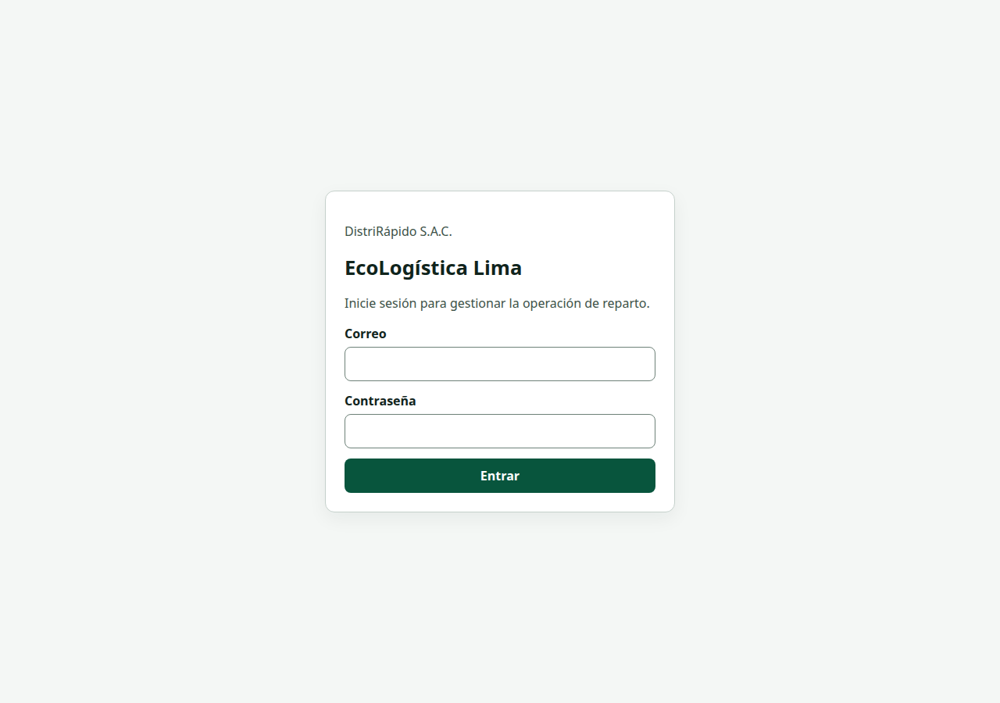
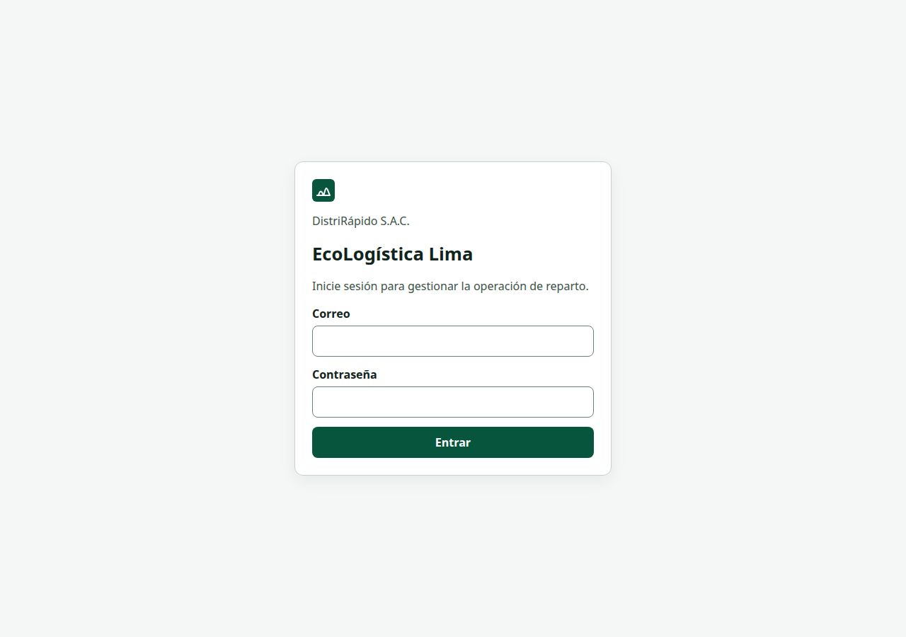

[← Volver al README Principal](../../../README.md) · [Estándares de ingeniería de software](./02%20Estandares%20Ingenier%C3%ADa%20de%20software%20V_1_0_0.md)

# Informe de reducción del impacto ambiental

**Proyecto:** EcoLogística Lima – optimizador de rutas sostenibles para DistriRápido S.A.C.  
**Líder del Proyecto:** Carhuapoma Fano, Eilene Elizabeth  
**Versión:** 1.0.2  
**Fecha:** 12 de noviembre de 2026  
**Fecha de modificación:** 13/11/2026  
**Equipo:** EcoLogística Lima — Carhuapoma Fano, Eilene Elizabeth; Cruz Salazar, Jorge Luiz; Estrada Flores, Axel Sebastian; Huaman Baldeon, Katheryn Elena; Leon Taza, Brayan Angel.  
**Stack medido:** React 18, TypeScript y Vite en `frontend/`; FastAPI y SQLAlchemy 2 sobre Python 3.12 en `backend/app`; PostgreSQL 16 con PostGIS.

El ejemplo de cátedra está escrito para MongoDB, Express, React y Node.js. Este informe adapta las ocho áreas a la arquitectura real del repositorio. No se reescribió el sistema como MERN.

## 1.1 Introducción y propósito

La eficiencia del software condiciona la energía que consumen el centro de datos, la red y el equipo del operador. Cada columna que PostgreSQL no envía, cada módulo de React que el navegador no descarga y cada respuesta que el cliente revalida con un ETag evitan trabajo que, en el modelo Sustainable Web Design versión 4, se atribuye a gramos de CO₂ equivalente.

El propósito de este documento es:

1. Registrar el estado de la pantalla de acceso y de los listados de la API antes de la intervención.
2. Documentar las ocho refactorizaciones con el código que estaba en el repositorio y el código que quedó.
3. Publicar las mediciones de Lighthouse y de tiempo de API tal como salieron de la ejecución, sin sustituirlas por las cifras del ejemplo.
4. Calcular la energía y las emisiones con los coeficientes publicados del Sustainable Web Design Model v4, mostrando cada producto.

## 1.2 Diagnóstico inicial

La auditoría se hizo el 12 de noviembre de 2026 sobre la compilación de producción anterior al cambio (`npm run build` y `vite preview` en `http://127.0.0.1:4173/login`). Lighthouse 12.6.1, preset de escritorio, un solo recorrido, throttling simulado de escritorio (RTT 40 ms, 10 240 kbps, CPU ×1). La pantalla es el inicio de sesión, que no llama a la API. El informe completo está en [lighthouse-antes.json](./evidencias/lighthouse-antes.json) y [lighthouse-antes.html](./evidencias/lighthouse-antes.html).

La API se volvió a medir el 13 de noviembre de 2026 porque la serie del 12 de noviembre (2,3117 ms) no tenía las veinte muestras guardadas. El procedimiento es el mismo: Uvicorn en `http://127.0.0.1:8000`, PostgreSQL 16.15 con PostGIS 3.4.2, `Accept-Encoding: identity` y 20 llamadas por listado. El código anterior es el commit `f9a079b`. En la base había 4 vehículos, 2 clientes y un usuario GERENTE creado para la medición; conductores, pedidos y rutas estaban vacíos porque las migraciones de demostración no los siembran. La media es la media aritmética de las seis medias. Las muestras están en [api-antes-2026-11-13.json](./evidencias/api-antes-2026-11-13.json).

| Indicador | Valor medido |
|---|---|
| Performance (Lighthouse, escritorio) | 100 / 100 |
| First Contentful Paint | 325,7629 ms (0,3 s en el informe) |
| Largest Contentful Paint | 325,7629 ms (0,3 s) |
| Total Blocking Time | 0 ms |
| Cumulative Layout Shift | 0 |
| Peso transferido | 80 875 bytes |
| Peticiones HTTP de la pantalla | 3 (documento, CSS y JS) |
| Imágenes de la pantalla | 0 |
| Media de los seis listados de la API | 2,7300 ms |

Las seis medias anteriores, en milisegundos y a 4 decimales, fueron: vehículos 3,2706; conductores 2,5686; pedidos 2,4148; clientes 2,3081; rutas 3,2351; usuarios 2,5830. Su suma es 16,3802 y 16,3802 / 6 = 2,730033, que la tabla redondea a 2,7300 ms. Conductores, pedidos y rutas devolvieron 2 bytes (`[]`).

El archivo de esa compilación, reconstruido el 13 de noviembre de 2026, es `assets/index-BDhcsrlj.js` (228 848 bytes) y `assets/index-dOuTtAU1.css` (21 303 bytes). Esos tamaños son el `resourceSize` de [lighthouse-antes.json](./evidencias/lighthouse-antes.json). Vite imprime «228,84 kB» y «21,30 kB» al dividir entre 1 000 y redondear. La columna gzip de Vite dice 71,97 kB y 8,16 kB: es la etiqueta del reporter, no el `transferSize`. El `transferSize` del JavaScript en ese JSON es 71 567 bytes. El mismo archivo, servido el 13 de noviembre de 2026 con `vite preview` y `Accept-Encoding: gzip`, entregó un cuerpo de 71 152 bytes en `Transfer-Encoding: chunked`; Chrome suma además las cabeceras y el entramado de los trozos. El detalle está en [tamanos-activos-2026-11-13.json](./evidencias/tamanos-activos-2026-11-13.json). `App.tsx` importaba todas las páginas y el CSS de Leaflet viajaba con la hoja principal. Los listados devolvían un arreglo, con `limite` predeterminado de 100 y tope de 200. `select(Usuario)` leía también `password_hash`. No había `Cache-Control` ni `ETag` en la API, ni compresión de las respuestas.

La pantalla ya era ligera. Por eso el puntaje de Lighthouse partía de 100 y el margen de mejora está en el peso, en el alcance de las consultas y en el límite de crecimiento, no en un salto de 38 a 96 puntos como el del ejemplo de cátedra.



## 1.3 Las ocho optimizaciones

### 1. Consultas magras e índices

**Diagnóstico.** SQLAlchemy 2 no tiene el `.lean()` de Mongoose. El equivalente aplicable es no hidratar columnas que la respuesta no usa. El listado de usuarios ejecutaba `select(Usuario)` y, por tanto, leía `password_hash`, `creado_en` y `actualizado_en` aunque `UsuarioOut` no los publica. En pedidos, cada fila llamaba a `db.get(Cliente)` y a una consulta PostGIS propia.

La migración `001` ya indexaba estado, placa, fecha y varias claves foráneas. No había índice en `detalle_ruta(id_ruta)`, `ruta(id_job)`, `pedido(creado_en)`, `conductor(nombre)` ni en el par `(fecha, generada_en)` con el que se ordena el plan.

**Antes**

```python
def listar_usuarios(db: Session, limite: int) -> list[Usuario]:
    return list(db.scalars(select(Usuario).order_by(Usuario.email).limit(limite)).all())
```

**Después**

```python
COLUMNAS_LISTADO = (
    Usuario.id_usuario,
    Usuario.email,
    Usuario.rol,
    Usuario.estado,
    Usuario.intentos_fallidos,
    Usuario.bloqueado_hasta,
)

def consulta_listado():
    return select(Usuario).options(load_only(*COLUMNAS_LISTADO)).order_by(Usuario.email)
```

El SQL compilado de `consulta_listado()` no contiene `password_hash`. Lo cubre `test_la_consulta_de_usuarios_no_trae_el_hash`. El listado de pedidos une el nombre del cliente en la misma sentencia y resuelve los distritos con un único `unnest` y un `LATERAL` sobre `distrito_cobertura`. Los índices nuevos están en `backend/alembic/versions/005_indices_listados.py`.

### 2. Paginación de 12 registros

**Diagnóstico.** Los `GET` de vehículos, conductores, pedidos, clientes, usuarios y rutas devolvían un arreglo. El límite predeterminado era 100, y el de rutas era un `limit(100)` fijo. El cliente pedía la colección completa.

**Antes**

```python
@router.get("", response_model=list[VehiculoOut])
def listar(
    db: Annotated[Session, Depends(get_db)],
    _: Annotated[Usuario, Depends(require_roles(*LECTURA_FLOTA))],
    limite: Annotated[int, Query(ge=1, le=200)] = 100,
) -> list:
    return servicio.listar_vehiculos(db, limite)
```

**Después**

```python
@router.get("", response_model=Pagina[VehiculoOut])
def listar(
    db: Annotated[Session, Depends(get_db)],
    _: Annotated[Usuario, Depends(require_roles(*LECTURA_FLOTA))],
    page: Annotated[int, Query(ge=1)] = 1,
    limite: Annotated[int, Query(ge=1, le=50)] = 12,
) -> dict:
    return servicio.listar_vehiculos(db, page, limite)
```

La respuesta es `{ items, total, page, page_size, total_pages }`. El tamaño operativo es 12 y el tope es 50. En el cliente, `rutaPagina` añade `page` y `limite=12`, y `Paginador` muestra Anterior y Siguiente cuando hay más de una página. Con los cuatro vehículos de demostración la primera página los contiene todos; la página 9 vuelve `items` vacío y conserva `total`. Lo afirma `test_listado_de_flota_pagina_de_a_doce`.

### 3. Imágenes WebP y AVIF

**Diagnóstico.** El repositorio no contiene fotografías PNG ni JPEG de producto. La interfaz es texto, CSS y, en la ruta, teselas PNG de OpenStreetMap más marcadores vectoriales (`circleMarker`). Añadir un banner convertido a WebP solo para mostrar un `<picture>` habría aumentado la transferencia. No se hizo.

Lo aplicable fue:

- Dejar escrito `ImagenAdaptativa`, que emite `<picture>` con `source` AVIF, `source` WebP e `img` de respaldo con `width`, `height` y `decoding="async"`. El componente está cubierto por prueba y no se monta en el inicio de sesión, porque no hay fotografía que servir.
- Pedir las teselas sin la variante retina. Leaflet, si `detectRetina` queda activo en una pantalla de alta densidad, solicita PNG al doble de resolución.

**Antes**

```tsx
const teselas = L.tileLayer("https://tile.openstreetmap.org/{z}/{x}/{y}.png", {
  attribution: "&copy; OpenStreetMap",
  maxZoom: 18,
});
```

**Después**

```tsx
export function opcionesTesela(attribution: string) {
  return {
    attribution,
    maxZoom: 18,
    detectRetina: false as const,
    updateWhenIdle: true,
  };
}
```

`ImagenAdaptativa`, en `frontend/src/imagen.tsx`, emite el `<picture>` que la rúbrica pide. No está montado en ninguna pantalla: el único import fuera de su módulo está en `frontend/src/imagen.test.tsx`. Montarlo en el inicio de sesión, sin una fotografía que servir, habría añadido bytes.

```tsx
<picture>
  {avif ? <source srcSet={avif} type="image/avif" /> : null}
  {webp ? <source srcSet={webp} type="image/webp" /> : null}
  
</picture>
```

OpenStreetMap publica esas teselas en PNG. El navegador no puede negociar AVIF contra ese servidor sin un proxy, y un proxy de teselas queda fuera del alcance de esta actividad. La pantalla de acceso sigue sin imágenes: Lighthouse contó 0 bytes de imagen antes y después.

### 4. Code splitting con React.lazy y Suspense

**Diagnóstico.** `App.tsx` importaba en estático Flota, Conductores, Pedidos, Rutas, Tablero, Usuarios y Modo conductor. El JavaScript de entrada pesaba 228,84 kB. Leaflet ya se importaba con `import("leaflet")` dentro del mapa, pero su CSS entraba en la hoja principal porque la página de rutas formaba parte del grafo inicial.

**Antes**

```tsx
import { ConductoresPage } from "./pages/ConductoresPage";
import { FlotaPage } from "./pages/FlotaPage";
import { LoginPage } from "./pages/LoginPage";
import { ModoConductorPage } from "./pages/ModoConductorPage";
import { DashboardPage } from "./pages/DashboardPage";
import { PedidosPage } from "./pages/PedidosPage";
import { RutasPage } from "./pages/RutasPage";
import { UsuariosPage } from "./pages/UsuariosPage";
```

**Después**

```tsx
const FlotaPage = lazy(() => import("./pages/FlotaPage").then((m) => ({ default: m.FlotaPage })));
const RutasPage = lazy(() => import("./pages/RutasPage").then((m) => ({ default: m.RutasPage })));
```

El inicio de sesión sigue en el grafo inicial. El resto cuelga de `<Suspense>` dentro de `Shell`. La compilación posterior deja `assets/index-DwllJXwe.js` en 191 197 bytes (Vite imprime 191,19 kB) y `assets/index-CFXIjgCs.css` en 6 436 bytes (Vite imprime 6,43 kB). Esos tamaños son el `resourceSize` de [lighthouse-despues.json](./evidencias/lighthouse-despues.json). El gzip de nivel 6 de ese JavaScript pesa 62 629 bytes: es el archivo `.gz` y también el cuerpo que entregó `vite preview` el 13 de noviembre. Vite imprime «63,41 kB» en la columna gzip; esa etiqueta no es el archivo ni el `transferSize` de 63 036 bytes registrado el 12 de noviembre para ese script. El CSS de Leaflet está en `assets/RutasPage-vh-t_kPv.css`, 15 095 bytes (Vite imprime 15,09 kB), y no se pide en `/login`.

### 5. Bibliotecas pesadas y API nativa

**Diagnóstico.** `frontend/package.json` no depende de Moment, Lodash, Axios ni date-fns. El acceso HTTP ya es `fetch`. Leaflet se conserva: el mapa lo necesita y ya entra por importación dinámica. Sustituirlo por una API nativa dejaría el producto sin trazado.

Lo que sí estaba repetido era el armado manual de la fecha local en el tablero, en rutas y en pedidos (`getFullYear`, `padStart`). Esa función local se reemplazó por `Intl.DateTimeFormat`.

**Antes**, en `RutasPage.tsx` y en `DashboardPage.tsx`:

```tsx
function fechaHoy(): string {
  const fecha = new Date();
  const mes = String(fecha.getMonth() + 1).padStart(2, "0");
  const dia = String(fecha.getDate()).padStart(2, "0");
  return `${fecha.getFullYear()}-${mes}-${dia}`;
}
```

**Después**, en `frontend/src/fechas.ts`:

```tsx
export function fechaHoy(ahora: Date = new Date()): string {
  const partes = new Intl.DateTimeFormat("en-CA", {
    year: "numeric",
    month: "2-digit",
    day: "2-digit",
  }).formatToParts(ahora);
  const valor = (tipo: Intl.DateTimeFormatPartTypes) =>
    partes.find((parte) => parte.type === tipo)?.value ?? "";
  return `${valor("year")}-${valor("month")}-${valor("day")}`;
}
```

`en-CA` con `formatToParts` produce `YYYY-MM-DD` en la zona horaria del entorno, igual que el código anterior. La prueba fija el 12 de noviembre de 2026 y espera `2026-11-12`.

### 6. SVG crítico en línea

**Diagnóstico.** No había archivos SVG ni un sprite de iconos. La marca era solo el texto del título, así que no existía una petición de icono que eliminar. El cambio aplicable es dibujar la marca en el propio documento, con ancho y alto explícitos, para no añadir una solicitud ni un desplazamiento de layout.

**Antes**, en `frontend/src/pages/LoginPage.tsx`, la tarjeta abría así, sin figura:

```tsx
<section className="tarjeta" aria-labelledby="titulo-login">
  <p className="muted">DistriRápido S.A.C.</p>
  <h1 id="titulo-login" className="marca">EcoLogística Lima</h1>
```

**Después**

```tsx
export function Marca({ tono = "oscuro" }: Props) {
  const fondo = tono === "claro" ? "#ffffff" : "#08553d";
  const trazo = tono === "claro" ? "#08553d" : "#ffffff";
  return (
    <svg className="marca-logo" viewBox="0 0 32 32" width="32" height="32" aria-hidden="true" focusable="false">
      <rect width="32" height="32" rx="6" fill={fondo} />
      <path d="M7 23h18M9 23c2-7 4-7 6-2s3-8 5-8 3 6 5 10" fill="none" stroke={trazo} strokeWidth="2" strokeLinecap="round" />
    </svg>
  );
}
```

El título sigue siendo el nombre accesible. El SVG está oculto a la tecnología de asistencia. En la barra verde se usa el tono claro para mantener contraste.

### 7. Caché en servidor y en cliente

**Diagnóstico.** Las respuestas de la API no traían `Cache-Control` ni `ETag`. El cliente volvía a pedir el mismo listado en cada montaje del componente. No se incorporó TanStack Query: la biblioteca pesa más de lo que este cliente necesita (YAGNI) y el criterio admite un caché equivalente.

**Antes.** `SecurityHeadersMiddleware` solo añadía cabeceras de seguridad. Ese bloque sigue en el archivo y no escribe `ETag` ni `Cache-Control`:

```python
headers["X-Content-Type-Options"] = "nosniff"
headers["X-Frame-Options"] = "DENY"
headers["Referrer-Policy"] = "no-referrer"
headers["Permissions-Policy"] = "geolocation=(), microphone=(), camera=()"
```

En el cliente, `FlotaPage` pedía la colección en cada montaje. `llamar` ejecuta `fetch` a través de `api`:

```tsx
llamar<Vehiculo[]>("/vehiculos")
  .then((lista) => {
    setVehiculos(lista);
```

**Después.** `RespuestaEficienteMiddleware`, en `_emitir`, calcula un ETag débil con SHA-256 del cuerpo sin comprimir. En un `GET` 200 distinto de `/health` envía la caché privada y, si `If-None-Match` coincide, responde 304 con cuerpo vacío. `/health` queda en `no-store`.

```python
if metodo == "GET" and ruta not in _SIN_CACHE and int(inicio["status"]) == 200:
    etag = _etag(cuerpo)
    headers["ETag"] = etag
    headers["Cache-Control"] = "private, max-age=30, must-revalidate"
    _vary(headers)
    if _coincide(peticion.get("if-none-match", ""), etag):
        inicio["status"] = 304
        headers["Content-Length"] = "0"
```

`_vary` añade `Accept-Encoding, Authorization`. El dato autenticado no se marca como público.

En el cliente, `frontend/src/consulta.ts` guarda la respuesta 30 segundos. `FlotaPage` ya no llama a `llamar` directo para el listado:

```tsx
consultar(llamar, rutaPagina("/vehiculos", pagina))
```

```tsx
export async function consultar<T>(
  pedir: (path: string) => Promise<T>,
  path: string,
  forzar = false,
): Promise<T> {
  const ahora = Date.now();
  const previo = memoria.get(path);
  if (!forzar && previo && previo.expira > ahora) {
    return previo.datos as T;
  }
  const datos = await pedir(path);
  memoria.set(path, { expira: ahora + VIGENCIA_MS, datos });
  return datos;
}
```

`VIGENCIA_MS` es 30 000. Una mutación vacía esa memoria. No se incorporó TanStack Query. La prueba de conductores y de flota sigue viendo el error de red porque cada montaje de prueba limpia el caché.

### 8. Compresión Brotli y Gzip

**Diagnóstico.** Uvicorn no comprimía el JSON. Las respuestas de listado de la demostración pesan menos de 1 KiB; comprimirlas no compensa. OpenAPI sí: 32 944 bytes sin codificar.

**Después**, en `backend/app/core/compresion.py`:

```python
def codificar(cuerpo: bytes, accept_encoding: str) -> tuple[bytes, str | None]:
    if len(cuerpo) < UMBRAL_BYTES:
        return cuerpo, None
    algoritmo = negociar(accept_encoding)
    if algoritmo == "br" and brotli is not None:
        return brotli.compress(cuerpo, quality=5), "br"
    if algoritmo == "gzip":
        return gzip.compress(cuerpo, compresslevel=5), "gzip"
    return cuerpo, None
```

Sobre `/openapi.json`, medido de nuevo el 13 de noviembre de 2026 contra Uvicorn: 32 944 bytes sin codificar, 4 075 bytes con Brotli calidad 5 y 4 381 bytes con Gzip nivel 5. Las tres respuestas están en [api-despues-2026-11-13.json](./evidencias/api-despues-2026-11-13.json). Se prefiere Brotli cuando el cliente lo anuncia. El paquete `brotli==1.1.0` está en `backend/requirements.txt`.

Los activos que sirve el propio frontend se precomprimen al compilar (`.br` y `.gz` a partir de 1 024 bytes) y `frontend/scripts/servir.mjs` los entrega con `Content-Encoding`. El archivo `assets/index-DwllJXwe.js.br` pesa 59 975 bytes. Contra ese servidor, el 13 de noviembre, `Content-Length` fue 59 975 y las cabeceras HTTP/1.1 sumaron 313 bytes. 59 975 + 313 = 60 288, que es el `transferSize` de ese script en [lighthouse-ci.json](./evidencias/lighthouse-ci.json). La cabecera de caché de ese activo es `Cache-Control: public, max-age=31536000, immutable`. El HTML de entrada queda en `no-cache` porque no lleva hash en el nombre.

## 1.4 Tabla comparativa

Las dos filas de Lighthouse son el mismo procedimiento: Lighthouse 12.6.1, preset de escritorio, `http://127.0.0.1:4173/login`, `vite preview`, un recorrido. La variación porcentual usa el valor numérico. Un signo positivo es un aumento.

| Indicador | Antes | Después | Variación absoluta | Variación |
|---|---:|---:|---:|---:|
| Performance | 100 / 100 | 100 / 100 | 0 | 0 % |
| FCP | 325,7629 ms | 326,8678 ms | +1,1049 ms | +0,34 % |
| LCP | 325,7629 ms | 366,8678 ms | +41,1049 ms | +12,62 % |
| TBT | 0 ms | 0 ms | 0 ms | 0 % |
| CLS | 0 | 0 | 0 | 0 % |
| Peso transferido | 80 875 bytes | 67 259 bytes | −13 616 bytes | −16,84 % |
| Peticiones | 3 | 4 | +1 | +33,33 % |
| Media de los seis listados | 2,7300 ms | 3,6340 ms | +0,9040 ms | +33,11 % |
| Emisión media por visita | 0,009049184625 g CO₂e | 0,007525676769 g CO₂e | −0,001523507856 g | −16,84 % |

13 616 / 80 875 = 0,1683586. El peso y la emisión bajan en la misma proporción porque el modelo atribuye las emisiones a los bytes transferidos. La fila de emisión usa los gramos de la sección 1.5 sin redondear, para que 0,009049184625 − 0,007525676769 = 0,001523507856. La versión 1.0.0 escribía −0,001524 g, que es el redondeo del ahorro exacto, y no cerraba con 0,009049 − 0,007526. El LCP de este recorrido subió 41 ms y el FCP 1 ms. Siguen muy por debajo de los umbrales de la rúbrica en escritorio. La petición adicional es el runtime que Vite separa al partir las rutas.

El tiempo de API de la tabla es la medición del 13 de noviembre, no la del 12. 3,6340 − 2,7300 = 0,9040 y 0,9040 / 2,7300 = 0,331135, esto es +33,11 %. Sube porque cada `GET` ahora calcula el ETag y arma el sobre de paginación; con cuatro vehículos el ahorro de columnas no compensa ese trabajo en localhost. Las seis medias posteriores, a 4 decimales, fueron: vehículos 4,2293; conductores 3,1938; pedidos 4,5751; clientes 3,1319; rutas 3,5950; usuarios 3,0790. Su suma es 21,8041 y 21,8041 / 6 = 3,634017, que la tabla redondea a 3,6340 ms. El 304 del listado de vehículos se comprobó (cuerpo de 0 bytes) y su media de 20 llamadas fue 3,5197 ms. En este volumen la revalidación no es más barata que responder el JSON. Las muestras están en [api-despues-2026-11-13.json](./evidencias/api-despues-2026-11-13.json).

Una segunda medición, solo del estado posterior, usó el servidor estático del repositorio y Lighthouse 12.1.0 dentro de Lighthouse CI: performance 100, FCP 323,7459 ms, LCP 363,7459 ms, TBT 0 ms, CLS 0, 64 250 bytes y 4 peticiones. No tiene par anterior con ese servidor, así que no entra en la tabla. Sirve para comprobar que Brotli y las aserciones del flujo de integración pasan.

En el preset móvil simulado (RTT 150 ms, 1 638 kbps, CPU ×4), el mismo servidor y Lighthouse 12.6.1 dieron, el 12 de noviembre de 2026 a las 01:59 UTC: performance 100, FCP 1 351,7659 ms, LCP 1 351,7659 ms, TBT 0 ms, CLS 0 y 64 250 bytes. El FCP móvil no cumple el umbral de 1,0 s. El LCP numérico sí cumple 1,4 s. El informe principal de la actividad es el de escritorio, porque la consola de planificación se usa en un puesto de trabajo y es la condición en la que existen el antes y el después.

## 1.7 Todas las pantallas, en frío y en una sesión

La sección 1.4 sigue siendo el par del 12 de noviembre, solo `/login`, con `vite preview`. El 13 de noviembre se midió el resto de la consola. No hay pantalla de clientes: el listado vive dentro de Pedidos. El flujo de CI ahora levanta PostgreSQL/PostGIS, aplica las migraciones, siembra un administrador, un conductor y una ruta del día con una parada, arranca la API y sirve el frontend con `servir.mjs` haciendo de proxy. La sesión va en la cookie `ecologistica_sesion`, porque Lighthouse abre otra pestaña y `sessionStorage` no la acompaña. Cada URL se mide en frío (caché HTTP vaciada) con Lighthouse 12.1.0, el que trae `@lhci/cli@0.14.0`, preset de escritorio. El antes es el commit `f9a079b`, servido por el mismo `servir.mjs` para que la compresión no explique la diferencia. Los JSON y HTML están en `evidencias/lighthouse-antes-<pantalla>.*` y `evidencias/lighthouse-despues-<pantalla>.*`. El resumen está en [lighthouse-antes-resumen.json](./evidencias/lighthouse-antes-resumen.json) y [lighthouse-despues-resumen.json](./evidencias/lighthouse-despues-resumen.json).

| Pantalla | Momento | Score | FCP (ms) | LCP (ms) | TBT (ms) | CLS | Peso (bytes) | Peticiones |
|---|---|---:|---:|---:|---:|---:|---:|---:|
| `/login` | Antes | 100 | 322,7863 | 322,7863 | 0 | 0 | 77 238 | 3 |
| `/login` | Después | 100 | 321,1227 | 361,1227 | 0 | 0 | 64 356 | 4 |
| `/dashboard` | Antes | 100 | 324,9092 | 324,9092 | 0 | 0 | 77 984 | 4 |
| `/dashboard` | Después | 100 | 348,0221 | 455,2354 | 0 | 0 | 67 330 | 7 |
| `/flota` | Antes | 100 | 323,7259 | 365,5889 | 0 | 0,003680 | 78 434 | 4 |
| `/flota` | Después | 100 | 349,2974 | 457,4758 | 0 | 0,003680 | 69 082 | 7 |
| `/conductores` | Antes | 100 | 325,5644 | 368,3466 | 0 | 0 | 77 858 | 4 |
| `/conductores` | Después | 100 | 347,3308 | 453,9292 | 0 | 0 | 68 096 | 7 |
| `/pedidos` | Antes | 100 | 330,0060 | 376,0090 | 0 | 0 | 78 768 | 5 |
| `/pedidos` | Después | 100 | 351,1614 | 465,4582 | 0 | 0 | 70 345 | 9 |
| `/usuarios` | Antes | 100 | 323,2469 | 364,8703 | 0 | 0 | 78 107 | 4 |
| `/usuarios` | Después | 100 | 347,5370 | 454,2592 | 0 | 0 | 68 444 | 7 |
| `/modo` | Antes | 100 | 321,3086 | 321,3086 | 0 | 0 | 77 238 | 3 |
| `/modo` | Después | 100 | 346,1909 | 411,4290 | 0 | 0 | 65 462 | 5 |
| `/rutas` | Antes | 97 | 328,1308 | 372,1962 | 0 | 0,105814 | 745 517 | 24 |
| `/rutas` | Después | 100 | 368,1905 | 580,5048 | 0 | 0,038150 | 746 019 | 29 |

En todas las pantallas el score es al menos 97, el FCP queda bajo 0,37 s, el LCP bajo 0,59 s, el TBT es 0 y el peso queda bajo 1,1 MB. El inicio de sesión baja 12 882 bytes (77 238 − 64 356). Las pantallas de listado bajan entre 8 y 11 kB porque el CSS de Leaflet ya no viaja en la hoja inicial. Suben las peticiones: Vite separa un runtime y el chunk de cada página.

La única meta de la rúbrica que no se cumple es el CLS de `/rutas`. Antes era 0,105814. Reservar 28 rem para el mapa, también en el estado vacío, lo bajó a 0,038150. Sigue por encima de 0,02. Lighthouse le da score 1 porque su umbral «bueno» es 0,1: el resto del desplazamiento lo producen las teselas y los controles de Leaflet al pintarse. El flujo acepta hasta 0,1 solo en `/rutas` y mantiene 0,02 en las demás. No se aflojó el peso: 746 019 bytes caben en 1,1 MB. Redis no entra en el job: abrir el mapa no encola una optimización.

### Sesión completa y SWDM v4

Una sesión recorre las ocho URL en el mismo documento, con la caché caliente. Los bytes son la suma de `encodedDataLength` (cuerpo y cabeceras), el mismo criterio que el `transferSize` de Lighthouse. No es la suma de la tabla: esa suma contaría ocho veces el JavaScript de entrada.

| Momento | Bytes de la sesión |
|---|---:|
| Antes (`f9a079b`) | 546 697 |
| Después | 560 178 |

La diferencia es +13 481 bytes (+2,47 %). Casi todo el recorrido son teselas de OpenStreetMap: 458 748 bytes antes y 470 376 después. Sin el mapa, el resto de la sesión son 87 949 bytes antes y 89 802 después. Partir el código aligera la primera pantalla y, en un recorrido que abre todos los módulos, esos chunks se descargan igual.

Se usan los mismos coeficientes de la sección 1.5: 0,300 kWh/GB, 494 g/kWh, factor de visita media 0,755 y `GB = bytes / 1 000 000 000`.

Antes, 546 697 bytes: `GB = 0,000546697`. Primera visita `0,000546697 × 0,300 × 494 = 0,0810204954 g`. Visita media `× 0,755 = 0,061170474027 g`.

Después, 560 178 bytes: `GB = 0,000560178`. Primera visita `0,000560178 × 0,300 × 494 = 0,0830183796 g`. Visita media `× 0,755 = 0,062678876598 g`.

La visita media de la sesión sube 0,001508402571 g. Con el supuesto de 36 000 sesiones al año son 54,30 g CO₂e más, no menos. El ahorro de la sección 1.5 sigue siendo el de la pantalla de acceso medida el 12 de noviembre. No describe un recorrido que abre el mapa.

## 1.5 Análisis con el Sustainable Web Design Model v4

Fuente de los coeficientes y de la fórmula: [Estimating Digital Emissions](https://sustainablewebdesign.org/estimating-digital-emissions/), versión 4. La intensidad de la red eléctrica por defecto es 494 g CO₂e/kWh (Ember, promedio mundial). Las intensidades de energía, ya redondeadas por los autores del modelo, son:

| Segmento | Operativa (kWh/GB) | Incorporada (kWh/GB) |
|---|---:|---:|
| Centros de datos | 0,055 | 0,012 |
| Redes | 0,059 | 0,013 |
| Dispositivos de usuario | 0,080 | 0,081 |

Esas cifras salen de dividir el consumo anual publicado (290, 310 y 421 TWh operativos; 62, 68 y 430 TWh incorporados) entre 5,29 ZB de tráfico (IEA 2022, Malmodin 2023, ITU 2023) y redondear. Este informe usa los coeficientes redondeados que publica el modelo, no el cociente sin redondear.

La suma de las seis intensidades es 0,300 kWh/GB. Con factor de hosting verde igual a 0, la primera visita emite:

`g CO₂e = GB × 0,300 kWh/GB × 494 g CO₂e/kWh = GB × 148,2`

El hosting de esta medición es localhost. No está verificado en la Green Web Foundation, así que el factor de hosting verde es 0 y no se anula la parte operativa del centro de datos.

La fórmula publicada de la visita media es:

`media = primera × proporción de visitantes nuevos + primera × proporción de retorno × (1 − proporción de caché)`

Los tres factores no salen del texto de la página del SWDM, que deja las proporciones como variables. Salen de las constantes de CO₂.js, la implementación de referencia de la Green Web Foundation, en [`src/constants/index.js`](https://github.com/thegreenwebfoundation/co2.js/blob/main/src/constants/index.js): `FIRST_TIME_VIEWING_PERCENTAGE = 0.75`, `RETURNING_VISITOR_PERCENTAGE = 0.25` y `PERCENTAGE_OF_DATA_LOADED_ON_SUBSEQUENT_LOAD = 0.02`. El modelo versión 3 las aplica por defecto. El `perVisit` de la versión 4, si no se le pasan opciones, calcula solo la primera visita (factor 1, retorno 0 y recarga 0). Este informe aplica las constantes a la fórmula de la visita media publicada en la página del modelo. El 0,02 es la fracción que el retorno vuelve a descargar, esto es `1 − 0,98`, así que la proporción de caché de datos es 0,98. El factor de la visita media queda:

`0,75 + 0,25 × 0,02 = 0,755`

Usar 1 en lugar de 0,755 cambia los gramos absolutos y deja igual el −16,84 %, porque el factor multiplica los dos escenarios.

El ejemplo de cátedra multiplica por 0,815 kWh/GB y por 442 g/kWh, y además el producto 0,008203 × 0,815 × 442 no da los 2,15 g que publica. Esos coeficientes no son los de la versión 4 y esa aritmética no se reproduce aquí.

El byte se convierte a gigabyte decimal, como pide el modelo al hablar de GB: `GB = bytes / 1 000 000 000`. No se divide entre 1 024.

### Escenario anterior: 80 875 bytes

`GB = 80 875 / 1 000 000 000 = 0,000080875`

| Segmento | kWh = GB × intensidad | g CO₂e = kWh × 494 |
|---|---:|---:|
| Centro de datos, operativo | 0,000080875 × 0,055 = 0,000004448125 | 0,002197373750 |
| Red, operativa | 0,000080875 × 0,059 = 0,000004771625 | 0,002357182750 |
| Dispositivo, operativo | 0,000080875 × 0,080 = 0,000006470000 | 0,003196180000 |
| Centro de datos, incorporado | 0,000080875 × 0,012 = 0,000000970500 | 0,000479427000 |
| Red, incorporada | 0,000080875 × 0,013 = 0,000001051375 | 0,000519379250 |
| Dispositivo, incorporado | 0,000080875 × 0,081 = 0,000006550875 | 0,003236132250 |
| Primera visita | 0,000024262500 kWh | 0,011985675000 g |
| Visita media (× 0,755) | 0,0000183181875 kWh | 0,009049184625 g |

Comprobación de la suma de gramos de la primera visita: 0,002197373750 + 0,002357182750 + 0,003196180000 + 0,000479427000 + 0,000519379250 + 0,003236132250 = 0,011985675000. Por 0,755: 0,009049184625 g CO₂e por visita.

### Escenario posterior: 67 259 bytes

`GB = 67 259 / 1 000 000 000 = 0,000067259`

| Segmento | kWh = GB × intensidad | g CO₂e = kWh × 494 |
|---|---:|---:|
| Centro de datos, operativo | 0,000067259 × 0,055 = 0,000003699245 | 0,001827427030 |
| Red, operativa | 0,000067259 × 0,059 = 0,000003968281 | 0,001960330814 |
| Dispositivo, operativo | 0,000067259 × 0,080 = 0,000005380720 | 0,002658075680 |
| Centro de datos, incorporado | 0,000067259 × 0,012 = 0,000000807108 | 0,000398711352 |
| Red, incorporada | 0,000067259 × 0,013 = 0,000000874367 | 0,000431937298 |
| Dispositivo, incorporado | 0,000067259 × 0,081 = 0,000005447979 | 0,002691301626 |
| Primera visita | 0,000020177700 kWh | 0,009967783800 g |
| Visita media (× 0,755) | 0,0000152341635 kWh | 0,007525676769 g |

### Ahorro y proyección anual

Ahorro por visita media: 0,009049184625 − 0,007525676769 = 0,001523507856 g CO₂e.  
Ahorro de energía por visita media: 0,0000183181875 − 0,0000152341635 = 0,000003084024 kWh.

**Supuesto de visitas, no medido:** 15 personas de operación × 240 días laborables × 10 vistas de la consola = 36 000 visitas al año. Es una hipótesis de uso interno de DistriRápido. No es el tráfico observado y no se toma el medio millón de visitas del ejemplo.

| Concepto | Cálculo | Resultado |
|---|---|---:|
| Emisión anual anterior | 0,009049184625 g × 36 000 / 1 000 | 0,3257706465 kg CO₂e |
| Emisión anual posterior | 0,007525676769 g × 36 000 / 1 000 | 0,270924363684 kg CO₂e |
| Ahorro anual | 0,001523507856 g × 36 000 | 54,846282816 g CO₂e |
| Ahorro anual en kilogramos | 54,846282816 / 1 000 | 0,054846282816 kg CO₂e |

El ahorro absoluto es pequeño porque la pantalla ya transfería 81 kB. El modelo es atribucional y de frontera amplia: no aísla el CPU de PostgreSQL ni el de Vite. Sirve para no publicar una cifra incompatible con los bytes medidos. No se convierte el resultado a árboles ni a kilómetros de automóvil: el Sustainable Web Design Model v4 no define ese factor, y el ejemplo de cátedra lo añadía sin fuente.

## 1.6 Evidencias

Condición común del par antes/después: 12 de noviembre de 2026, Lighthouse 12.6.1, preset desktop, pantalla `http://127.0.0.1:4173/login`, compilación `vite build` servida con `vite preview`.

| Evidencia | Archivo |
|---|---|
| JSON anterior | [lighthouse-antes.json](./evidencias/lighthouse-antes.json) |
| HTML anterior | [lighthouse-antes.html](./evidencias/lighthouse-antes.html) |
| Captura anterior | [login-antes.png](./evidencias/login-antes.png) |
| JSON posterior, mismo procedimiento | [lighthouse-despues.json](./evidencias/lighthouse-despues.json) |
| HTML posterior | [lighthouse-despues.html](./evidencias/lighthouse-despues.html) |
| Captura posterior | [login-despues.png](./evidencias/login-despues.png) |
| JSON del servidor Brotli (Lighthouse CI 12.1.0) | [lighthouse-ci.json](./evidencias/lighthouse-ci.json) |
| HTML de esa corrida | [lighthouse-ci.html](./evidencias/lighthouse-ci.html) |
| JSON móvil simulado, solo el después | [lighthouse-movil-despues.json](./evidencias/lighthouse-movil-despues.json) |
| API anterior, 20 muestras, 13/11/2026 | [api-antes-2026-11-13.json](./evidencias/api-antes-2026-11-13.json) |
| API posterior, 304 y OpenAPI, 13/11/2026 | [api-despues-2026-11-13.json](./evidencias/api-despues-2026-11-13.json) |
| Tamaños de los activos y su relación con `transferSize` | [tamanos-activos-2026-11-13.json](./evidencias/tamanos-activos-2026-11-13.json) |



Los umbrales de la rúbrica (performance ≥ 90, FCP ≤ 1,0 s, LCP ≤ 1,4 s, TBT ≤ 85 ms, CLS ≤ 0,02 y peso ≤ 1,1 MB) se cumplen en el preset de escritorio, antes y después. En el preset móvil simulado, medido solo después, el FCP de 1,352 s no cumple 1,0 s. El resto de umbrales móviles sí se cumple, con LCP numérico de 1,352 s.

La relación con ISO/IEC 25010, los cuatro principios de la Green Software Foundation, las pautas reales de W3C WSG y la matriz de las ocho optimizaciones está en el [informe de estándares](./02%20Estandares%20Ingenier%C3%ADa%20de%20software%20V_1_0_0.md).

## Historial de control de cambios

El nombre del archivo sigue en `V_1_0_0`, igual que el resto de los informes de `docs/03 Implementación`. La versión vive en la cabecera.

| Versión | Fecha | Autor | Descripción |
|---|---|---|---|
| 1.0.0 | 12/11/2026 | Equipo EcoLogística Lima | Informe inicial, con el par Lighthouse de escritorio y el cálculo SWDM v4. |
| 1.0.1 | 13/11/2026 | Equipo EcoLogística Lima | Código ANTES/DESPUÉS de las áreas 3, 6 y 7; líder del proyecto; nueva medición de API, 304, OpenAPI y Brotli; explicación de las etiquetas en kB frente a `transferSize`; redondeo de la fila de emisión; origen de los factores 0,75 / 0,25 / 0,02. |
| 1.0.2 | 13/11/2026 | Equipo EcoLogística Lima | Lighthouse de las ocho pantallas, con API y mapa. La sesión completa no baja de peso: la dominan las teselas. El CLS de `/rutas` baja de 0,106 a 0,038 y sigue sobre 0,02. |
